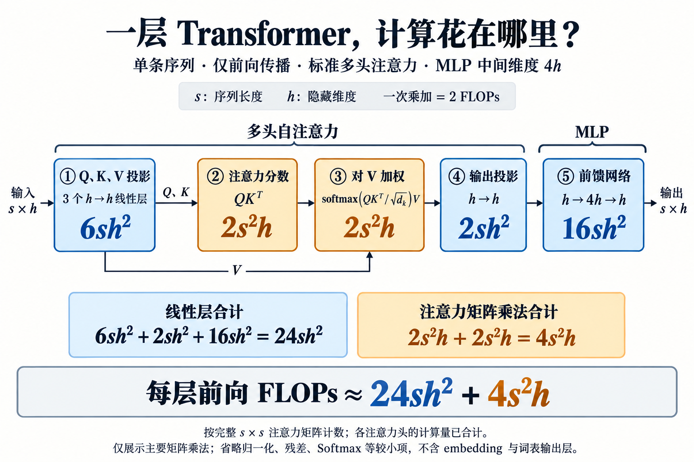
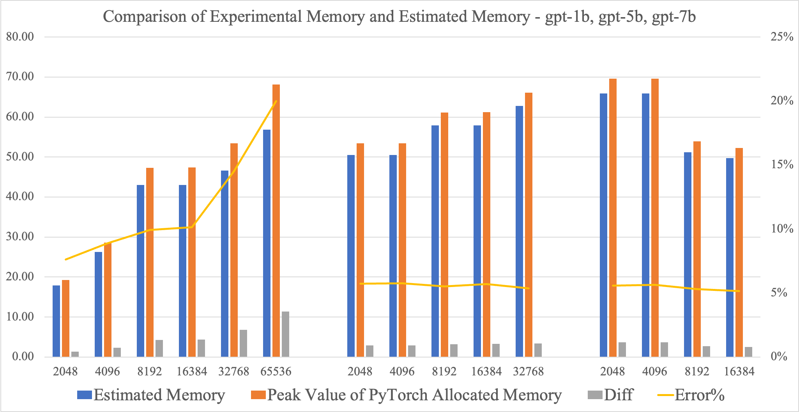
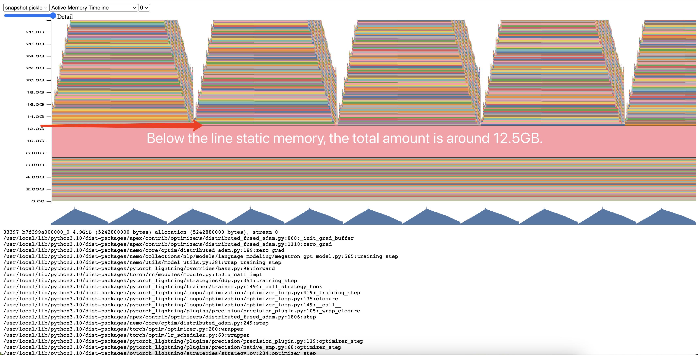
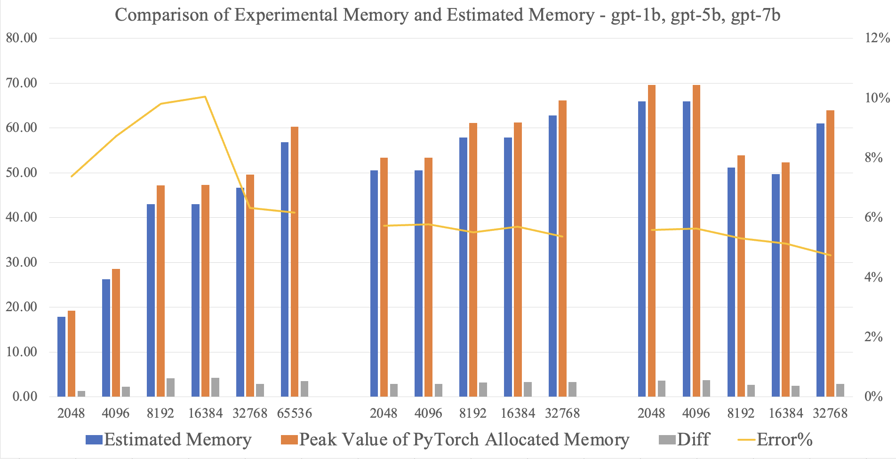

假设手里有一批 GPU，准备训练一个 7B 模型。最先冒出来的问题往往很直接：这些卡够不够？要跑多久？把上下文从 2K 拉到 8K，会贵多少？

查资料时，很容易碰到一个简洁得有点让人不放心的公式：

$$
C \approx 6ND
$$

参数量乘上 token 数，再乘以 6，就能估算训练计算量。一个那么复杂的 Transformer，真能这么算？

这个公式确实有用。不过，要把它变成可靠的训练预算，还得知道那个 6 从哪来、它省略了什么，以及算出来的数字如何换成天数。

本文以 Adam Casson 的 [Transformer FLOPs](https://www.adamcasson.com/posts/transformer-flops) 为计算量部分的线索，结合 Jianbin Chang 的 [GPT Training Memory Estimation — NeMo Practice](https://shjwudp.github.io/blog/2023/gpt-training-memory-estimation-nemo-training-practice/) 讨论显存约束。下面主要考虑稠密、decoder-only Transformer 的全参数训练；MoE、参数高效微调和推理需要另算。

## **先把三个容易混在一起的量分开**

估算训练资源时，我们实际上在问三个问题：

| 量 | 回答的问题 | 常见单位 |
| --- | --- | --- |
| 计算量 FLOPs | 总共要做多少次浮点运算？ | FLOPs、PFLOPs |
| 算力 FLOP/s | 每秒能完成多少次浮点运算？ | TFLOP/s、PFLOP/s |
| 显存 | 训练过程中要同时存下多少东西？ | GB、GiB |

可以把它们想成做饭：计算量是要处理多少食材，算力是处理食材的速度，显存是操作台有多大。操作台不够，得分批处理，或者把一些东西临时挪走；这些安排又会影响速度。

这也解释了为什么“模型权重能放进显存”和“模型能训练起来”之间，还有很长一段距离。

## **那个 6，是从矩阵乘法里来的**

先看一个普通的线性层：

$$
Y=XW
$$

假设输入有 $T$ 个 token，$X$ 的形状是 $T\times h$，权重 $W$ 的形状是 $h\times k$。矩阵乘法的主要计算量约为：

$$
C_{\mathrm{forward}}\approx 2Thk
$$

这里采用常见的计数约定：一次乘法算一次，一次加法也算一次。所以，一次乘加按 2 FLOPs 计算。

这个线性层有 $hk$ 个权重。平均到每个 token，前向传播大约需要“参数量的两倍”次运算。

训练还要反向传播。对这个线性层来说，主要需要再算两次矩阵乘法：

$$
\frac{\partial \mathcal{L}}{\partial X}
=\frac{\partial \mathcal{L}}{\partial Y}W^\top,
\qquad
\frac{\partial \mathcal{L}}{\partial W}
=X^\top\frac{\partial \mathcal{L}}{\partial Y}
$$

因此，反向传播的主要计算量约为前向的两倍。合起来就是：

$$
\underbrace{2N}_{\text{前向}}
+\underbrace{4N}_{\text{反向}}
\approx 6N
\quad\text{FLOPs/token}
$$

再乘上训练期间累计处理的 token 数 $D$，就得到：

$$
\boxed{C_{\mathrm{train}}\approx 6ND}
$$

这里的 $D$ 要按实际处理次数累计。同一批 100B token 的数据完整训练三遍，在这笔账里就是 300B token。[Scaling Laws for Neural Language Models](https://arxiv.org/abs/2001.08361) 给出了这类估算的基础口径。

不过，$N$ 的定义需要说清楚。沿用早期 scaling law 的简化口径时，它主要指 Transformer 主体中的非 embedding 参数。拿模型标称的总参数量代入，适合先估数量级；如果要精算，就应该把主体线性层、输出词表投影和 attention 运算分别列出来。

## **把 Transformer 拆开，看看它省略了什么**

用一个最常见的结构做手算：模型有 $L$ 层，隐藏维度为 $h$，序列长度为 $s$，采用标准多头注意力，MLP 中间维度为 $4h$。

先沿着图里的箭头走一遍：输入先生成 Q、K、V，再计算注意力分数、对 V 加权，经过输出投影后进入 MLP。蓝色部分的计算量与 $sh^2$ 成正比，橙色部分与 $s^2h$ 成正比。

*图：单条序列经过一层 Transformer 时的主要前向计算。图中省略了归一化、残差等步骤，注意力按完整矩阵计数；所有注意力头的计算量已合计。*

下面计算的是“一条长度为 $s$ 的序列，经过一层时”的前向 FLOPs，忽略偏置、归一化和激活函数等较小项：

| 模块 | 主要计算 | 前向 FLOPs |
| --- | --- | --- |
| Q、K、V 投影 | 三个 $h\times h$ 线性层 | $6sh^2$ |
| Attention 输出投影 | 一个 $h\times h$ 线性层 | $2sh^2$ |
| MLP | $h\rightarrow4h\rightarrow h$ | $16sh^2$ |
| 注意力分数 | $QK^\top$ | $2s^2h$ |
| 对 V 加权 | $\operatorname{softmax}(QK^\top)V$ | $2s^2h$ |

于是，**一条长度为 $s$ 的序列，经过一层、做一次前向传播**的计算量约为：

$$
C_{\mathrm{layer,fwd}}
\approx 24sh^2+4s^2h
$$

先别急着把它写成整个训练的计算量。这里还差三个范围的变化：从一层到 $L$ 层，从前向到前向加反向，再从一条序列到全部训练数据。

第一步，把所有层加起来。一条序列经过整个 Transformer 主体，前向计算量约为：

$$
C_{\mathrm{seq,fwd}}
\approx L\left(24sh^2+4s^2h\right)
$$

第二步，加上反向传播。沿用前面“反向约为前向两倍”的矩阵乘法估算，一条序列完成前向和反向，合计约为前向的三倍：

$$
C_{\mathrm{seq,train}}
\approx 3L\left(24sh^2+4s^2h\right)
$$

第三步，覆盖全部训练数据。假设训练序列都长 $s$，累计处理 $D$ 个 token，就相当于处理了 $D/s$ 条序列。因此：

$$
\begin{aligned}
C_{\mathrm{train}}
&\approx \frac{D}{s}\times C_{\mathrm{seq,train}}\\
&\approx \frac{D}{s}\times3L\left(24sh^2+4s^2h\right)\\
&=72LDh^2+12LDsh
\end{aligned}
$$

这也解释了为什么第一项中的 $s$ 消失了：序列越长，每条序列的线性层计算越多，但在 $D$ 固定时，序列条数也越少，两者正好抵消。注意力矩阵乘法原本随 $s^2$ 增长，抵消一次后，还剩一个 $s$。

现在再引入参数量。这个结构每层的主要参数量为：

$$
N_{\mathrm{layer}}\approx 12h^2
$$

所以整个 Transformer 主体的参数量 $N\approx12Lh^2$。把它代入上面的第一项，$72LDh^2=6ND$，就得到：

$$
\boxed{
C_{\mathrm{train}}
\approx \underbrace{6ND}_{\text{主体线性层}}
+\underbrace{12LDsh}_{\text{注意力矩阵乘法}}
}
$$

原来，$6ND$ 对应的是图中的蓝色部分，橙色部分需要另外补上。这两次注意力矩阵乘法没有对应的可训练权重，单纯数参数就会漏掉它们。这里的 $D$ 已经包含整个训练累计处理的 token，不需要再乘 batch size、训练步数或 GPU 数量。

## **那 6ND 到底会差多少？**

先只比较刚才推导出的两项。把注意力矩阵乘法的开销除以 $6ND$：

$$
\frac{C_{\mathrm{train}}-6ND}{6ND}
\approx\frac{12LDsh}{6\times12Lh^2\times D}
=\frac{s}{6h}
$$

这个比例回答的是：**补上注意力矩阵乘法后，比 $6ND$ 多算多少**。它取决于序列长度和模型宽度；同样的上下文长度，模型越宽，这部分相对开销越小。

例如，固定 $h=4096$，按上述结构手算：

| 序列长度 $s$ | 注意力矩阵乘法相对 $6ND$ 的额外开销 | 补上这一项后的主体计算量 |
| --- | --- | --- |
| 2048（2K） | 约 8.3% | 约 $1.083\times6ND$ |
| 8192（8K） | 约 33.3% | 约 $1.333\times6ND$ |
| 32768（32K） | 约 133.3% | 约 $2.333\times6ND$ |

注意百分比的分母：2K 这一行是“比 $6ND$ 多 8.3%”；如果以修正后的主体计算量为分母，$6ND$ 少算的比例约为 $8.3/108.3=7.7\%$。两种说法描述的是同一笔开销。

这些数值采用**完整 $s\times s$ 注意力矩阵**的计数口径。如果因果注意力内核跳过了上三角区域，两次注意力矩阵乘法的开销在长序列时可接近这里的一半。例如，2K 对应的额外开销就从约 8.3% 降到约 4.2%。这张表是公式推算，实际执行了多少计算，还取决于内核实现。

词表输出层也是一项遗漏。输入 embedding 通常是查表，但输出端需要把隐藏状态投影到整个词表。若词表大小为 $v$，每个 token 的前向投影约需 $2hv$ FLOPs，前向加反向累计约为 $6Dhv$。相对于这里的 $6ND$，它增加的比例约为：

$$
\frac{6Dhv}{6ND}
=\frac{hv}{N}
\approx\frac{v}{12Lh}
$$

例如 $L=32$、$h=4096$、$v=32000$ 时，输出投影额外增加约 2.0%。结合上面的 2K 配置，主体加输出投影的计算量约比 $6ND$ 多 10.4%；若注意力内核跳过上三角，则约多 6.2%。这里仍沿用“$N$ 只包含 Transformer 主体参数”的定义；如果用模型标称总参数量作为 $N$，就要重新核对词表矩阵是否已经计入，避免重复计算。

因此，**较短上下文、较宽模型下，$6ND$ 可以是不错的粗估；长上下文下，偏差可能达到几十个百分点，甚至更多。** 例如同样是 2K，若 $h$ 从 4096 增至 12288，完整注意力矩阵带来的额外开销就从约 8.3% 降到了约 2.8%。换成 GQA、SwiGLU 等结构时，也应按实际矩阵形状重新计算，不能直接套这组系数。

作为参考，[Chinchilla 论文附录 F、表 A4](https://arxiv.org/html/2203.15556v1) 给出的逐项计算结果与 $6ND$ 的比值为 0.99～1.10，说明在论文列出的模型配置和计数口径下，两种估算相当接近。该论文把 embedding 参数也计入 $N$，所以这组数字不能直接与上表混用，更不能理解为所有模型的误差都在 10% 以内。

最后还要留一笔账：上面比较的都是模型前向和反向所需的主要计算。如果训练开启激活重计算，GPU 还会执行额外运算，后文会解释其开销；通信和数据等待则主要影响耗时，不能直接当作遗漏的 FLOPs 加进来。

## **算出 FLOPs 后，怎么换成训练天数？**

假设要训练一个约 7B 参数的稠密模型，累计处理 300B token。先用标称参数量做粗估：

$$
C\approx6\times7\times10^9\times300\times10^9
=1.26\times10^{22}\ \mathrm{FLOPs}
$$

这仍然是 $6ND$ 的基线估算。要修正它，还需要具体的层数、隐藏维度、序列长度和词表大小；只有“7B”这个数字，无法确定误差比例。

接着假设使用 64 张 GPU，每张卡在所用精度下的理论峰值为 300 TFLOP/s。这里的硬件数字只是便于演算的假设。

直接用计算量除以峰值，得到的是过于乐观的时间。实际训练还有通信、数据读取、算子调度，以及显存限制带来的额外工作。

通常可以用模型 FLOPs 利用率，也就是 MFU，把这些影响折算进来：

$$
\mathrm{MFU}
=\frac{\text{每 token 的模型 FLOPs}\times\text{集群实际 tokens/s}}
{\text{集群理论峰值 FLOP/s}}
$$

于是：

$$
\boxed{
t\approx\frac{C}{G\,P_{\mathrm{GPU}}\,\mathrm{MFU}}
}
$$

其中 $G$ 是 GPU 数量，$P_{\mathrm{GPU}}$ 是单卡理论峰值。MFU 的定义和模型计算量口径可参见 [PaLM 论文附录 B](https://arxiv.org/html/2204.02311v5#A2)。峰值也要与实际使用的精度、稠密或稀疏计算方式匹配。$C$ 和 MFU 应采用同一套 FLOPs 口径：如果把 $C$ 换成含注意力修正项的值，实测 MFU 也要相应重算。

假设 MFU 为 40%，代入后：

$$
t\approx
\frac{1.26\times10^{22}}
{64\times300\times10^{12}\times0.4}
\approx1.64\times10^6\ \mathrm{s}
\approx19.0\ \text{天}
$$

同一批硬件，如果 MFU 只有 30%，约需 25.3 天；如果达到 50%，约需 15.2 天。

所以，比起报一个“预计 19 天”的单点数字，更有用的做法是给出假设和区间。这里算的是所选 FLOPs 口径对应的训练时间；评估、保存 checkpoint、故障恢复，以及前面省略的计算，都还需要结合实际任务考虑。

一旦有了短跑数据，还可以直接用吞吐估算：

$$
t\approx\frac{D}{\text{实测集群 tokens/s}}
$$

这通常更贴近当前配置，但短跑应覆盖稳定的完整训练步，包含反向传播、梯度累积和优化器更新。只测前向速度，会把训练时间估得太短。

## **算力账算完，还得看看显存账**

7B 模型使用 BF16 存权重，大约需要：

$$
7\times10^9\times2=14\ \mathrm{GB}
$$

可训练时还要存梯度和优化器状态。例如，一种混合精度 Adam 配置会保存：

| 内容 | 每个参数占用 |
| --- | --- |
| BF16 权重 | 2 bytes |
| BF16 梯度 | 2 bytes |
| FP32 主权重 | 4 bytes |
| FP32 一阶、二阶动量 | 8 bytes |
| 合计 | 16 bytes |

在这个配置下，尚未分片的静态状态就约为 $16N$ bytes，7B 模型约需 112 GB，约合 104.3 GiB。这里还没有算激活值。若梯度用 FP32 保存，或优化器采用其他状态布局，系数也会改变。[ZeRO 论文](https://arxiv.org/abs/1910.02054) 对这些状态及其分片方式做了系统分析。

Jianbin Chang 在 [GPT Training Memory Estimation — NeMo Practice](https://shjwudp.github.io/blog/2023/gpt-training-memory-estimation-nemo-training-practice/) 中给出了一个更具体的例子：在其分析的 NeMo、BF16、ZeRO-1 实现中，单卡静态显存近似为：

$$
M_{\mathrm{static}}
\approx\left(6+\frac{10}{d}\right)\frac{N}{t}
\quad\text{bytes}
$$

其中 $d$ 是数据并行度，$t$ 是张量并行度。这组系数来自该优化器的 FP32 梯度和权重余数等具体布局；它不能作为所有框架的通用公式。下面结合这篇 [NeMo 显存估算实践](https://shjwudp.github.io/blog/2023/gpt-training-memory-estimation-nemo-training-practice/) 的实验，看看这些估算在真实训练中表现如何。

激活值则是另一笔随输入规模变化的开销。传统实现如果保存完整注意力矩阵，就会出现与 $Lbas^2$ 成正比的显存项，其中 $b$ 是每卡 micro-batch size，$a$ 是注意力头数。因此，模型没有变，序列变长也可能导致 OOM。激活重计算和并行方式如何改变这些开销，可参见 [Reducing Activation Recomputation in Large Transformer Models](https://arxiv.org/abs/2205.05198)。

## **把公式放到真实训练里：一次 NeMo 显存实验**

Jianbin Chang 在 DGX-A100 上测试了三种 GPT-Next 模型，序列长度从 2048 扩展到 65536，并随配置调整张量并行度和 micro-batch size。实验使用的模型带有旋转位置编码和类似 LLaMA 的 MLP，具体规模如下：

| 原文模型名 | 层数 $L$ | 隐藏维度 $h$ | MLP 中间维度 $h_{ff}$ | 词表大小 $v$ | 参数量 |
| --- | --- | --- | --- | --- | --- |
| gpt-1b | 24 | 2048 | 5440 | 50257 | $1.41\times10^9$ |
| gpt-5b | 24 | 4096 | 10880 | 50257 | $5.23\times10^9$ |
| gpt-7b | 32 | 4096 | 10880 | 50257 | $6.84\times10^9$ |

*数据来源：Jianbin Chang，[原文 §3.1 Experimental Setup](https://shjwudp.github.io/blog/2023/gpt-training-memory-estimation-nemo-training-practice/#31-experimental-setup)。模型名称和数值照录；这里的 MLP 结构与前文用于手算的 $4h$ MLP 不同，估算时应采用各自的结构。*

选出 gpt-7b 的六组配置，更容易看清显存花在了哪里。表中 $d$ 为数据并行度，$t$ 为张量并行度，$b$ 为每卡 micro-batch size；估算采用原文的 BF16、ZeRO-1、张量并行及选择性激活重计算配置。

| 序列长度 $s$ | $d$ | $t$ | $b$ | 静态显存估算 | 激活显存估算 | 交叉熵额外开销估算 | 总显存估算 |
| --- | --- | --- | --- | --- | --- | --- | --- |
| 2048 | 8 | 1 | 2 | 46.25 | 19.42 | 0.77 | 66.44 |
| 4096 | 8 | 1 | 1 | 46.25 | 19.42 | 0.77 | 66.44 |
| 8192 | 4 | 2 | 1 | 27.11 | 23.45 | 1.15 | 51.72 |
| 16384 | 2 | 4 | 1 | 17.54 | 31.52 | 1.15 | 50.21 |
| 32768 | 1 | 8 | 1 | 12.76 | 47.64 | 1.15 | 61.55 |
| 65536 | 1 | 8 | 1 | 12.76 | 95.28 | 2.30 | 110.34 |

*数据节选自 [原文 §3.1 的测试配置与显存估算表](https://shjwudp.github.io/blog/2023/gpt-training-memory-estimation-nemo-training-practice/#31-experimental-setup)。显存列沿用原文数值及 GB 标注，未重新换算；合计可能存在末位舍入差异。以上均为估算值，实测对比见下图。*

这里有两个值得停下来看的地方。2K 到 4K 时，$b$ 从 2 降为 1，每个 micro-batch 的 token 数 $sb$ 没变，表中的激活显存估算也相同。4K 到 8K 时，总显存估算反而下降，因为张量并行度同时从 1 增加到了 2。拿不同配置比较时，不能只盯着序列长度。

*图：Jianbin Chang，[原文 §3.2 Results and Analysis](https://shjwudp.github.io/blog/2023/gpt-training-memory-estimation-nemo-training-practice/#32-results-and-analysis)，[原图链接](https://shjwudp.github.io/assets/posts/2023-08-22-gpt-training-memory-estimation-nemo-training-practice/image-4.png)，未经改绘。蓝柱为估算值，橙柱为 PyTorch allocated 显存实测峰值，灰柱为差值，黄线为相对估算值的误差。*

作者报告，gpt-5b 和 gpt-7b 的误差约为 5%，但 gpt-1b 在长序列配置下偏差更大。这个现象提醒我们：模型规模较小时，框架缓冲区等开销可能更难被“参数量乘一个系数”覆盖。

## **差出来的显存，藏在优化器的 bucket 里**

为了追查偏差，作者检查了 gpt-1b、64K 序列配置的 memory snapshot：静态显存估计为 3.61 GB，实际却约为 12.5 GB。

*图：Jianbin Chang，[原文 §3.2](https://shjwudp.github.io/blog/2023/gpt-training-memory-estimation-nemo-training-practice/#32-results-and-analysis)，[原图链接](https://shjwudp.github.io/assets/posts/2023-08-22-gpt-training-memory-estimation-nemo-training-practice/image-6.png)，未经改绘。图中红色标注指出了持续占用的静态显存区域。*

问题出在 `apex.distributed_fused_adam` 的 bucket：它把梯度等数据放进连续缓冲区，以提高批量处理效率。该实验设置了 200 MB 的 bucket，而张量并行度为 4 时，作者认为约 50 MB 就够了。参数被切小了，缓冲区却没有相应缩小，于是留下了额外占用。调整后，作者重新做了实验：

*图：Jianbin Chang，[原文 §3.2 修正优化器 bucket 后的结果](https://shjwudp.github.io/blog/2023/gpt-training-memory-estimation-nemo-training-practice/#32-results-and-analysis)，[原图链接](https://shjwudp.github.io/assets/posts/2023-08-22-gpt-training-memory-estimation-nemo-training-practice/image-7.png)，未经改绘。*

这些实验验证的是该 NeMo 配置下的显存估算，没有测量前文的 $6ND$ 或训练天数。对我们做预算的启发是：先把配置跑通，再测吞吐；显存预测出现明显偏差时，可以沿着快照里的常驻分配和临时峰值继续查。上述数据和图表均来自原作者实验，本文没有重新运行。

## **显存优化，也会反过来改变训练时间**

激活重计算的办法很直观：前向时少保存一些中间结果，反向需要时再算一遍。

如果近似多做一次完整前向，线性层部分的实际计算量就会从：

$$
6ND\quad\longrightarrow\quad8ND
$$

也就是增加约三分之一。选择性重计算只重算部分模块，开销则取决于具体策略。[Transformer FLOPs](https://www.adamcasson.com/posts/transformer-flops) 也讨论了这项额外计算。

这还带出 MFU 的一个细节：MFU 的分子按模型本来需要的计算量计数，HFU 则把重计算等实际执行的运算也纳入。因此，GPU 忙着重算时，硬件利用率可能很好看，模型训练进度却未必更快。[PaLM](https://arxiv.org/html/2204.02311v5#A2) 区分了这两种口径。

如果时间公式里已经用了包含重计算影响的实测 MFU，就继续用同口径的模型 FLOPs，不要再把分子从 $6ND$ 改成 $8ND$，否则会重复计入这笔开销。

FlashAttention 提供了另一个例子：它通过分块和减少高带宽显存读写，避免把完整注意力矩阵存进显存。标准稠密注意力的主要算术复杂度仍然是平方级，但内存访问方式变了，速度和显存占用就可能明显改善。只看 FLOPs，无法解释全部性能变化。[FlashAttention 论文](https://arxiv.org/abs/2205.14135)

真要给一次训练做预算，我会先用 $6ND$ 判断数量级；上下文较长时，再补注意力项和词表投影；然后核算显存，选定能跑的并行与重计算配置，最后用一段稳定短跑的吞吐校准时间。

最后拿到的最好是这样一句话：“在这套模型结构、序列长度和并行配置下，按实测吞吐预计需要多少天。”公式帮我们把账拆开，短跑则把这些账落到手里的机器上。

## **参考文章与论文**

1. Adam Casson，[Transformer FLOPs](https://www.adamcasson.com/posts/transformer-flops)，2023。本文计算量估算部分的主要参考。
2. Jianbin Chang，[GPT Training Memory Estimation — NeMo Practice](https://shjwudp.github.io/blog/2023/gpt-training-memory-estimation-nemo-training-practice/)，2023。本文 NeMo 显存公式、实验数据和三张实验图的来源；各图旁另附原图链接。
3. Kaplan et al.，[Scaling Laws for Neural Language Models](https://arxiv.org/abs/2001.08361)，2020。
4. Hoffmann et al.，[Training Compute-Optimal Large Language Models](https://arxiv.org/abs/2203.15556)，2022。
5. Chowdhery et al.，[PaLM: Scaling Language Modeling with Pathways](https://arxiv.org/abs/2204.02311)，2022。
6. Rajbhandari et al.，[ZeRO: Memory Optimizations Toward Training Trillion Parameter Models](https://arxiv.org/abs/1910.02054)，2019。
7. Korthikanti et al.，[Reducing Activation Recomputation in Large Transformer Models](https://arxiv.org/abs/2205.05198)，2022 年预印本，2023 年发表于 MLSys。
8. Dao et al.，[FlashAttention: Fast and Memory-Efficient Exact Attention with IO-Awareness](https://arxiv.org/abs/2205.14135)，2022。
