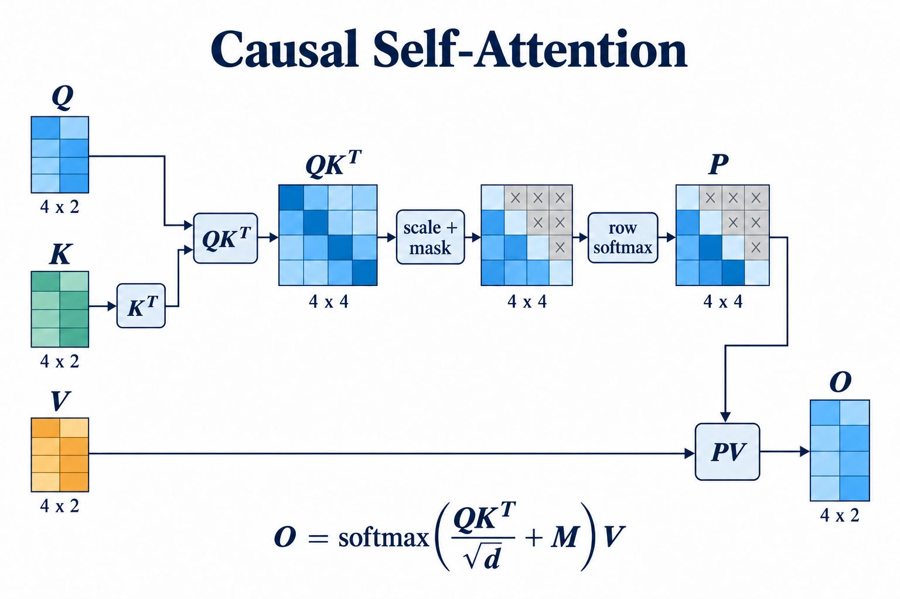
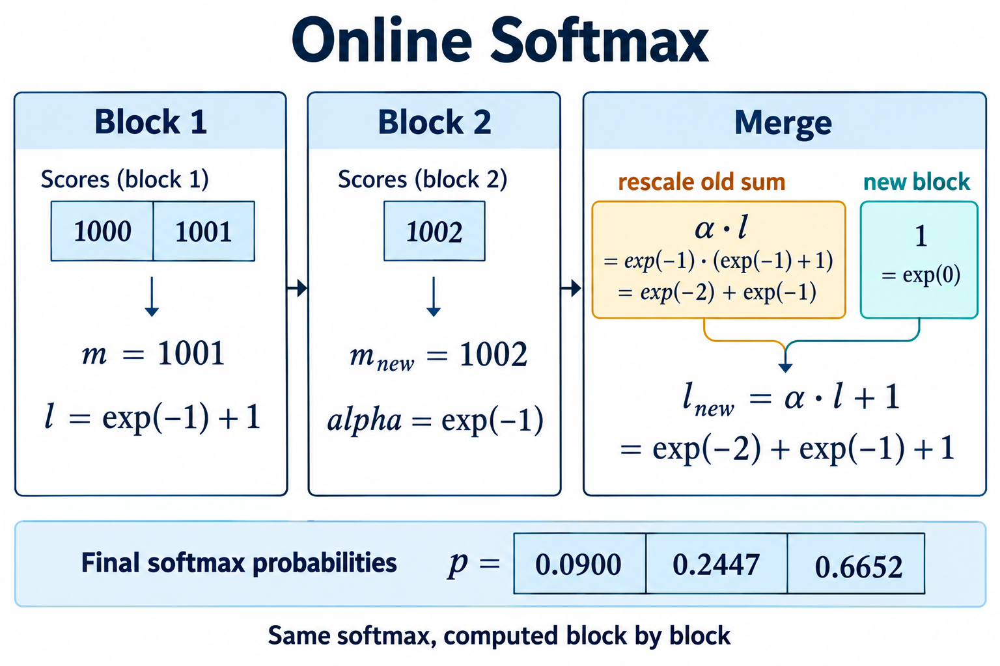
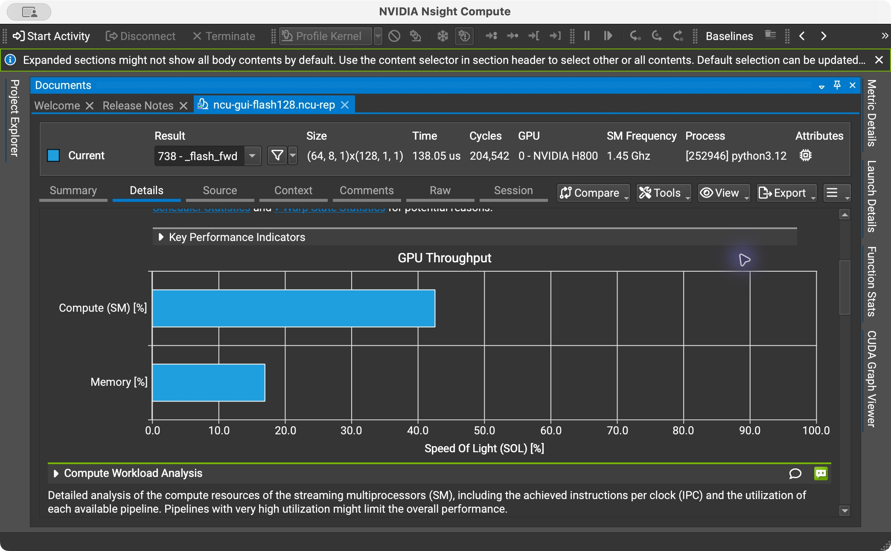
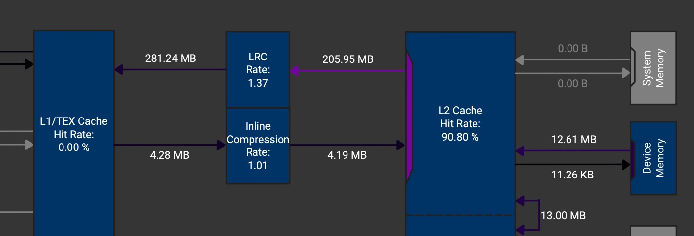
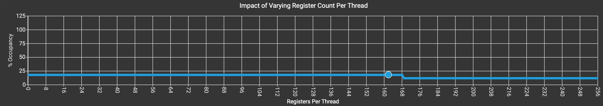
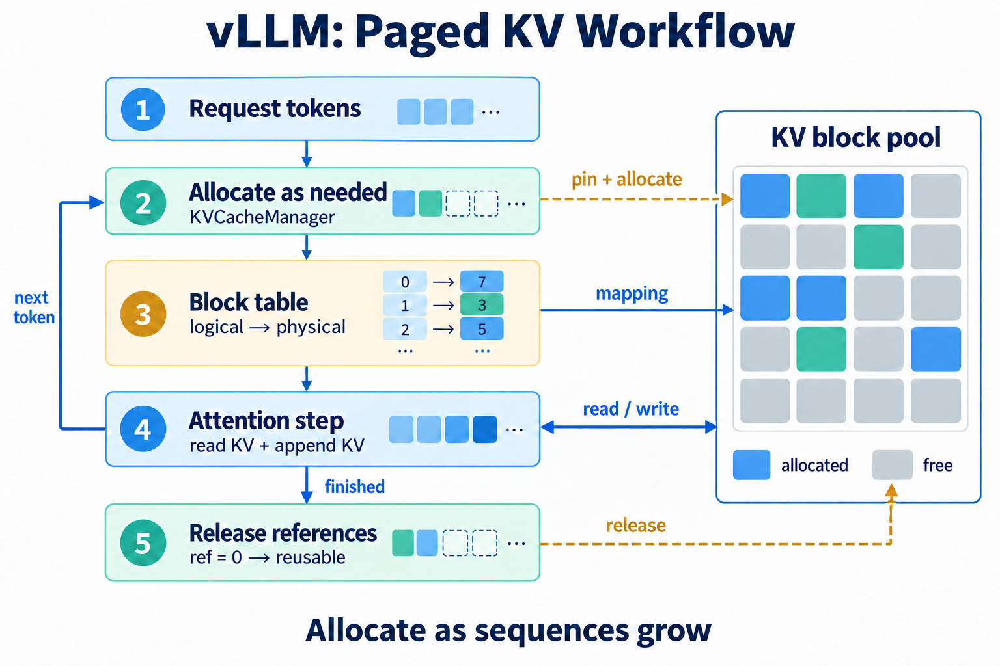
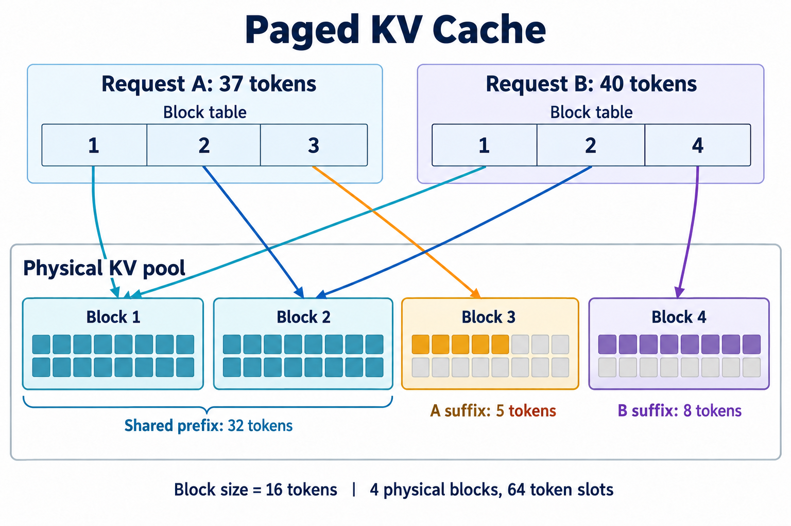
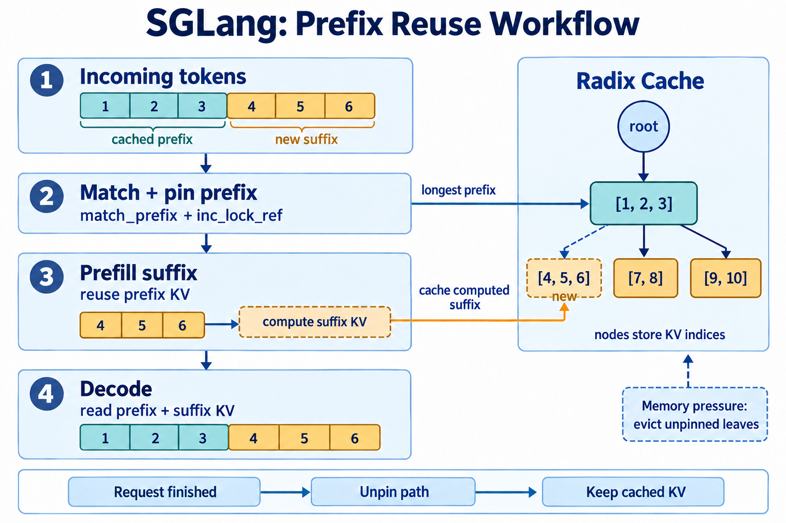

## 1. Attention 简介

先讲一些大家耳熟能详的概念。

Attention 根据 query 与 key 的相关性，对 value 做加权求和。Transformer 中，输入先经过线性投影得到 Q、K、V；对一个 head，计算为：

$$
S=\frac{QK^\top}{\sqrt d}+M,\qquad
P=\operatorname{softmax}(S),\qquad
O=PV
$$

在 self-attention 中，$Q,K,V\in\mathbb{R}^{N\times d}$，$N$ 是序列长度，$d$ 是 head dim。$S_{ij}$ 表示第 $i$ 个 token 对第 $j$ 个 token 的注意力分数，softmax 沿 key 方向逐行计算。缩放因子 $1/\sqrt d$ 用于控制点积的数值范围。

语言模型通常采用 causal mask：$j\le i$ 时 $M_{ij}=0$，否则为 $-\infty$。位置 $i$ 只能读取自己和此前的 token。



下面是直接按公式写出的 PyTorch 实现。多头输入的形状为 `[batch, heads, sequence, head_dim]`，矩阵乘法在最后两个维度上进行：

```python
def naive_attention(q, k, v):
    n = q.shape[-2]
    scores = (q @ k.transpose(-1, -2)) / math.sqrt(q.shape[-1])
    pos = torch.arange(n, device=q.device)
    scores.masked_fill_(pos[:, None] < pos[None, :], -float("inf"))
    return scores.softmax(dim=-1) @ v
```

推理分为 prefill 和 decode 两个阶段。prefill 一次处理输入中的多个 token，Q 和 K 的序列维度通常都很长。普通逐 token decode 每步只有一个新 query，历史 K、V 保存在 KV Cache 中，供新 query 读取。

prefill 的主要开销在大矩阵计算和中间结果的读写；decode 每步都要读取历史 KV，更依赖缓存容量和访存效率。

## 2. Attention 计算瓶颈及 Online Softmax 优化原理

### 2.1 中间矩阵的存储与读写

Naive Attention 分别执行矩阵乘法、缩放、mask、softmax 和第二次矩阵乘法。$S$ 和 $P$ 都是 $N\times N$ 的矩阵，需要在不同 kernel 之间写回显存，再重新读入。

以 batch 为 1、8 heads、序列长度 4096、FP16 为例，单个分数矩阵占用：

$$
1\times8\times4096^2\times2\ \mathrm{bytes}=256\ \mathrm{MiB}
$$

加上概率矩阵就是 512 MiB，而输出只有 4 MiB。序列长度翻倍，中间矩阵的大小变成四倍。这些中间结果带来的显存读写，是 Naive Attention 的一项主要开销。

如果把 Q、K、V 分块，每次只算一小块分数，就可以缩小临时存储。

### 2.2 在线更新 softmax 分母

稳定 softmax 的写法为：

$$
m=\max_j s_j,\qquad
\ell=\sum_j e^{s_j-m},\qquad
p_j=\frac{e^{s_j-m}}{\ell}
$$

减去最大值可以避免指数溢出。例如一行包含 `[1000, 1001, 1002]`，直接求指数会溢出；减去 1002 后，只需计算 $e^{-2},e^{-1},1$。

[Online Softmax](https://arxiv.org/abs/1805.02867) 在读取过程中维护最大值 $m$ 和指数和 $\ell$。假设已经处理的部分对应 $(m,\ell)$，新块的统计为 $(m_b,\ell_b)$，合并时有：

$$
\begin{aligned}
m'&=\max(m,m_b)\\
\ell'&=e^{m-m'}\ell+e^{m_b-m'}\ell_b
\end{aligned}
$$

其中 $e^{m-m'}\ell$ 把旧分母换到新的最大值基准下：

$$
e^{m-m'}\sum_j e^{s_j-m}=\sum_j e^{s_j-m'}
$$

因此不需要保存已经读过的全部分数，只保留两个统计量即可继续更新。对 `[1000, 1001, 1002]`，若前两个数为一块，则先得到 $m=1001$、$\ell=e^{-1}+1$；加入 1002 时，旧指数和乘上 $e^{-1}$，再加上 1，得到 $e^{-2}+e^{-1}+1$。



独立的 [online_softmax](experiments/attention.py) 实现按块求出最终的 $(m,\ell)$，然后再次读取输入，输出完整概率向量。

### 2.3 把 V 的加权和纳入在线计算

Attention 需要的输出是 $PV$，可以在更新 softmax 统计量时同时累加 V。对一行 query，维护未归一化的加权和：

$$
a=\sum_j e^{s_j-m}v_j
$$

读入新块 $s_b,V_b$ 后：

$$
\begin{aligned}
m'&=\max(m,\max s_b)\\
\alpha&=e^{m-m'}\\
p_b&=e^{s_b-m'}\\
\ell'&=\alpha\ell+\sum_j p_{b,j}\\
a'&=\alpha a+p_bV_b
\end{aligned}
$$

遍历完所有 block 后，输出 $o=a/\ell$。初始状态为 $m=-\infty,\ell=0,a=0$。

Python 中对应的更新如下：

```python
m_new = torch.maximum(m, s.amax(dim=-1))
alpha = torch.exp(m - m_new)
p = torch.exp(s - m_new[..., None])
acc = alpha[..., None] * acc + p @ v_block
l = alpha * l + p.sum(dim=-1)
m = m_new
```

`acc` 和 `l` 必须同时乘上 `alpha`，使历史加权和与历史分母使用同一个基准。每块的 $p_b$ 用完即可丢弃，最终也不需要输出完整的 $P$。

[FlashAttention](https://arxiv.org/abs/2205.14135) 将这套在线更新与分块计算融合到 GPU kernel 中，避免把完整的 $S$、$P$ 写入 HBM。

## 3. FlashAttention 的实现及 Triton 优化

### 3.1 Kernel 的组织方式

一个 Triton program 负责一个 batch/head 下的 $B_M$ 行 query，沿 K/V 方向每次处理 $B_N$ 个 token。grid 为：

```python
grid = (triton.cdiv(n, bm), batch * heads)
```

Q block 在循环前加载，`m`、`l` 和 `acc` 在循环中持续更新。Q/K/V 使用 FP16，统计量与累加器使用 FP32。主循环如下，完整代码见 [attention.py](experiments/attention.py)：

```python
for start in range(0, tl.minimum((tile + 1) * BM, N), BN):
    c = start + cols
    k = tl.load(K + base + dims[:, None] + c[None, :] * D,
                c[None, :] < N, other=0)
    v = tl.load(V + base + c[:, None] * D + dims[None, :],
                c[:, None] < N, other=0)

    s = tl.dot(q, k) * (1.0 / tl.sqrt(float(D)))
    s = tl.where((rows[:, None] >= c[None, :]) & (c[None, :] < N),
                 s, -float("inf"))
    m_new = tl.maximum(m, tl.max(s, axis=1))
    alpha = tl.exp(m - m_new)
    p = tl.exp(s - m_new[:, None])
    acc = acc * alpha[:, None] + tl.dot(p.to(tl.float16), v)
    l = alpha * l + tl.sum(p, axis=1)
    m = m_new

out = acc / l[:, None]
```

`rows` 和 `c` 使用全局 token 位置，保证不同 query 块的 causal mask 一致。循环终点只覆盖当前 query 块可能访问的 K/V，跳过完全处于上三角的块。对角线块内部仍有被 mask 的位置，实际计算量不会恰好减半。

第二次 `tl.dot` 前将 `p` 转为 FP16，用于 FP16 矩阵乘法；累加结果保留为 FP32。

实现可参考 [Triton 的 Fused Attention 教程](https://triton-lang.org/main/getting-started/tutorials/06-fused-attention.html)。

### 3.2 Benchmark

让我们来实测一下不同 Attention 实现的性能。测试使用单张 H800。

#### CUDA Graph 与 CUDA Event 计时

CUDA 调用是异步的，不做同步就直接在 CPU 上给 `fn()` 计时，通常只会测到任务提交的时间。这里用 [CUDA Event](https://docs.pytorch.org/docs/stable/generated/torch.cuda.Event.html) 在 GPU stream 上记录起止时间，再等结束事件完成后读取耗时。

对于只有几微秒的 kernel，Python 逐次调用还可能让 GPU 等待下一次任务提交。[CUDA Graph](https://docs.pytorch.org/docs/stable/notes/cuda.html#cuda-graphs) 将一组 GPU 操作提前 capture，之后通过一次 `replay()` 提交，减少这类间隙。

每个实现先 warmup 10 次，再用 CUDA Graph 录制 20 次调用，通过 CUDA Event 计时。重复 7 组，取单次调用耗时的中位数；各组复用同一组输入，未手动锁频。

以 Triton 64×128 为例，`fn` 固定使用已经分配好的 Q/K/V，计时代码如下：

```python
import statistics

fn = lambda: flash_attention(q, k, v, bm=64, bn=128)
for _ in range(10):
    fn()
torch.cuda.synchronize()

# 显存测量放在这里，见下文。
graph = torch.cuda.CUDAGraph()
with torch.cuda.graph(graph):
    for _ in range(20):
        out = fn()

samples_ms = []
for _ in range(7):
    start = torch.cuda.Event(enable_timing=True)
    end = torch.cuda.Event(enable_timing=True)
    start.record()
    graph.replay()
    end.record()
    end.synchronize()
    samples_ms.append(start.elapsed_time(end) / 20)

median_us = statistics.median(samples_ms) * 1000
```

capture 本身不计入耗时。两个 Event 在同一 stream 上包围 `graph.replay()`，`end.synchronize()` 保证 GPU 已经完成这组操作。`elapsed_time` 返回毫秒，除以 20 得到单次调用的平均耗时，再对 7 组结果取中位数。

| 序列长度 | Naive | Triton 64×64 | Triton 64×128 | PyTorch Flash SDPA |
| --- | --- | --- | --- | --- |
| 512 | 27.05 μs | 8.56 μs | 8.22 μs | 10.22 μs |
| 1024 | 66.93 μs | 15.52 μs | 14.44 μs | 16.45 μs |
| 2048 | 313.67 μs | 36.36 μs | 36.63 μs | 37.53 μs |
| 4096 | 1320.23 μs | 115.34 μs | 100.42 μs | 113.72 μs |

`64×128` 表示 $B_M=64,B_N=128$。PyTorch 对照使用 `sdpa_kernel(SDPBackend.FLASH_ATTENTION)` 强制选择 Flash 后端。

4K 时，64×128 相对 Naive 约快 13.1 倍，与 PyTorch Flash SDPA 的耗时接近。

#### 显存测量

显存测量放在 warmup 之后、graph capture 之前，单独执行一次 attention。CUDA Graph 会使用自己的 [memory pool](https://docs.pytorch.org/docs/stable/notes/cuda.html#graph-memory-management)，将两者分开可以避免把 graph 的内存保留算进单次调用。

```python
import gc

torch.cuda.synchronize()
gc.collect()
torch.cuda.empty_cache()
base = torch.cuda.memory_allocated()
torch.cuda.reset_peak_memory_stats()

out = fn()
torch.cuda.synchronize()
peak_extra_mib = (torch.cuda.max_memory_allocated() - base) / 2**20
del out
```

`base` 是调用前已有 tensor 的显存用量，`reset_peak_memory_stats()` 从这里重新统计峰值。即使分数矩阵、softmax 结果等临时 tensor 在调用结束前已经释放，[`max_memory_allocated()`](https://docs.pytorch.org/docs/stable/generated/torch.cuda.memory.max_memory_allocated.html) 仍会记录它们同时存活时的峰值。因此这里测的是包含输出的 peak allocated 增量，而非调用前后显存的差值，也不是 allocator 的 reserved 空间。


| 序列长度 | Naive 额外峰值 | Triton 64×128 额外峰值 |
| --- | --- | --- |
| 512 | 8.50 MiB | 0.50 MiB |
| 1024 | 33.01 MiB | 1.00 MiB |
| 2048 | 130.02 MiB | 2.00 MiB |
| 4096 | 516.03 MiB | 4.00 MiB |

Naive 的额外显存随 $N^2$ 增长，Triton kernel 只需额外分配输出，随 $Nd$ 增长。

### 3.3 分块大小与 Nsight Compute 分析

增大块大小可以减少循环次数，但也会提高片上资源占用。`acc` 的大小为 $B_M\times d$，临时分数块为 $B_M\times B_N$，两者都会影响寄存器或共享内存的使用。下面保持 $B_M=64$、`num_warps=4`、`num_stages=2`，比较 $B_N=64$ 和 $B_N=128$。

**采集报告**

Nsight Compute 分为命令行工具 `ncu` 和图形界面 `ncu-ui`。这里在 H800 上用 `ncu` 采集，再把报告拷回 Mac 查看；采集端版本为 2025.3.1，本机 GUI 为 2026.3.1。

[`bench_attention.py`](experiments/bench_attention.py) 的 `--profile` 分支固定使用 `[1, 8, 4096, 64]` 的 FP16 输入。先执行 3 次 warmup，完成 Triton 编译，再用 CUDA Profiler API 标出一次 attention 调用：

```python
for _ in range(3):
    fn(q, k, v)
torch.cuda.synchronize()
torch.cuda.cudart().cudaProfilerStart()
fn(q, k, v)
torch.cuda.synchronize()
torch.cuda.cudart().cudaProfilerStop()
```

在 GPU 机器上运行：

```bash
ncu --profile-from-start off --target-processes all \
  --section SpeedOfLight \
  --section LaunchStats --section Occupancy \
  --section MemoryWorkloadAnalysis --section MemoryWorkloadAnalysis_Chart \
  --section ComputeWorkloadAnalysis \
  --section SpeedOfLight_HierarchicalTensorRooflineChart \
  -o ncu-gui-flash128 \
  python bench_attention.py --profile flash128
```

`--profile-from-start off` 让采集从 `cudaProfilerStart()` 开始，跳过输入初始化和 warmup。将两处 `flash128` 换成 `flash64` 或 `naive`，即可采集另外两组。Naive 的一次 attention 包含多个 kernel，这里保留整个区间。

`-o` 保存 `.ncu-rep`，`--section` 决定报告包含哪些指标与图表。只导出几项指标的 CSV，无法还原下面这些图表。可用 `ncu --list-sections` 查看当前版本支持的 section，参数说明见 [Nsight Compute CLI 文档](https://docs.nvidia.com/nsight-compute/NsightComputeCli/index.html)。遇到 `ERR_NVGPUCTRPERM` 时，需要有 GPU performance counter 的访问权限。

**打开 GUI，先看吞吐率**

在本机 GUI 中通过 **File → Open** 打开 `.ncu-rep`，也可以直接运行 `ncu-ui ncu-gui-flash128.ncu-rep`。在 Summary 中双击 `_flash_fwd`，进入 Details。点击各 section 标题左侧的小三角展开图表；如果只看到部分内容，可通过标题栏的 content selector 切换显示项。[GUI 文档](https://docs.nvidia.com/nsight-compute/NsightCompute/index.html) 中也介绍了这些操作。

下面是本机打开 64×128 报告的截图，Speed Of Light 中选择了 GPU Throughput Chart：

[](assets/nsight/flash128-throughput.png)

横轴是相对理论峰值的利用率。Compute 约为 42.56%，Memory 约为 16.94%，说明这次执行没有把计算或访存单元的吞吐跑满。这里的 Memory 是多个存储相关单元的汇总指标，不能直接当作 HBM 带宽利用率；同一报告中的 DRAM Throughput 只有 2.73%。接下来还要看缓存、资源占用和调度情况，才能判断时间花在哪里。

**看数据在哪一层缓存复用**

展开 Memory Workload Analysis，将 Memory Chart 的 Values 设为 Transfer Size。下图截取了 L1/TEX、L2 和 Device Memory 之间的路径：

[](assets/nsight/flash128-memory.png)

沿箭头看数据传输方向，再看每条路径的字节数。这次 L2 Hit Rate 为 90.80%，Device Memory → L2 的读流量是 12.61 MB，约 12.03 MiB。Q/K/V 合计也只有 12 MiB，大部分重复读取由缓存承担。Naive 的 7 个 kernel 合计 DRAM 读流量约 1131.52 MiB，完整中间矩阵带来了大量额外读写。

图中 MB 使用十进制单位，表中的 MiB 使用 $2^{20}$ 字节。这里统计的是传输流量，显存峰值仍按 3.2 节的方法测量。

**把 occupancy 和耗时放在一起看**

Launch Statistics 可以看到每线程寄存器、每个 block 的 shared memory 和 grid 大小；Occupancy 则列出资源限制及实际活跃 warp 比例。两组报告的结果如下：

| 指标 | 64×64 | 64×128 |
| --- | --- | --- |
| NCU kernel 时长 | 150.05 μs | 138.05 μs |
| 每线程寄存器 | 119 | 162 |
| 每个 block 的共享内存（含 driver） | 41 KiB | 73 KiB |
| 寄存器 / 共享内存各自允许的驻留 block 数 / SM | 4 / 4 | 3 / 3 |
| Theoretical occupancy | 25.00% | 18.75% |
| Achieved occupancy | 17.90% | 14.83% |
| SM throughput 相对峰值 | 33.92% | 42.56% |

64×128 每个 block 有 4 个 warp，寄存器和共享内存都将每个 SM 的驻留 block 数限制为 3，因此理论 occupancy 为 $3\times4/64=18.75\%$。实际值为 14.83%，还受到调度、不同 block 执行时长等因素影响。

展开 Occupancy，选择 `% Occupancy Graphs`，可以看到改变资源用量后的理论 occupancy 曲线。圆点标出当前配置：

[](assets/nsight/flash128-occupancy.png)

这张曲线保持其他参数不变，只改变每线程寄存器数。左侧曲线仍停在 18.75%，是因为 shared memory 同样限制了驻留 block 数；只减少寄存器，并不能立刻提高 occupancy。曲线是资源模型的估算，具体配置是否更快，还要重新跑 benchmark。

$B_N$ 增大后，寄存器和共享内存用量增加，occupancy 下降，执行时间却缩短了。更大的 K/V block 减少了循环次数，可能是这组配置更快的原因之一。occupancy 要结合耗时看，数值更高不一定更快。GUI 中的 `Est. Speedup` 也只是分析规则给出的估算，不能当作已经测出的收益。

比较两份报告时，可以先打开 64×64，通过 **Compare → Add Baseline** 保存为基线，再切到 64×128 查看差异。原始报告：[64×64](experiments/nsight-reports/ncu-gui-flash64.ncu-rep)、[64×128](experiments/nsight-reports/ncu-gui-flash128.ncu-rep)、[Naive（gzip，解压后打开）](experiments/nsight-reports/ncu-gui-naive.ncu-rep.gz)。

NCU 为收集指标会 replay kernel，默认的 cache flush 和 clock control 也会影响耗时。因此这里使用同一批报告比较分块配置，与 3.2 节的 CUDA Graph benchmark 分开看，具体见 [Profiling Guide](https://docs.nvidia.com/nsight-compute/ProfilingGuide/index.html#cache-control)。

## 4. vLLM 的源码解读及实验

前面的 benchmark 测的是固定输入下的一次 attention。到了在线服务，请求不断到达，输入和输出长度各不相同，每条请求的 KV 还要随着生成持续增长。FlashAttention 减少了计算过程中的临时读写，这些历史 KV 仍需一直保存到请求结束。如果按最大长度提前预留空间，许多位置会长期空着，显存能容纳的并发请求也就少了。

[vLLM](https://arxiv.org/abs/2309.06180) 是面向大模型服务的推理框架。它通过 PagedAttention 将每条序列的 KV 拆成固定大小的块，随序列增长按需分配，再用 block table 让 attention kernel 找到对应的物理块。这样，长短不一的请求可以共用一个 KV 内存池，减少预留空间和碎片造成的浪费。

[](assets/generated-images/vllm-attention-workflow.png)

启用前缀缓存时，新请求在分配前还会查找可复用的完整块。后续每轮 decode 按需补充空间，请求结束后释放块引用。

### 4.1 KV Cache 的分页布局

对各层结构相同的普通 Transformer，单条序列的 KV 总量约为：

$$
M_{\mathrm{KV}}=2LTH_{\mathrm{KV}}db
$$

其中 $L$ 为层数，$T$ 为已缓存 token 数，$H_{\mathrm{KV}}$ 为 KV 头数，$d$ 为 head dim，$b$ 为每元素字节数。$L=32,T=8192,H_{\mathrm{KV}}=8,d=128,b=2$ 时，单条请求需要 1 GiB KV。这是张量并行切分前的总量；GQA 使用 KV 头数计算。

请求的长度会随生成增长。为每条请求提前保留最大长度的连续空间，会留下大量暂时用不到的位置。[PagedAttention](https://arxiv.org/abs/2309.06180) 将 KV 按固定 token 数分块，用 block table 将逻辑块映射到物理块，请求只需按当前长度分配空间。

例如 block size 为 16，请求 A 长 37，B 长 40，前 32 个 token 相同，可以使用下面的映射：



A、B 各持有一张 block table，前两个表项指向同一份 KV。对任意 token 位置，slot 换算为：

```python
logical_block, offset = divmod(token_position, block_size)
physical_block = block_table[logical_block]
slot = physical_block * block_size + offset
```

A 的位置 35 对应物理块 3、偏移 3，slot 为 51。每条序列的尾块最多留下 `block_size - 1` 个空槽。K/V 的具体布局可参考 [vLLM Paged Attention 文档](https://docs.vllm.ai/en/v0.11.0/design/paged_attention.html)。

### 4.2 从 KVCacheManager 到 BlockPool

这里使用 vLLM v0.11.0。[KVCacheManager](https://github.com/vllm-project/vllm/blob/v0.11.0/vllm/v1/core/kv_cache_manager.py) 管理请求所持有的块，coordinator 处理不同 KV cache group 的协调，底层物理块由 [BlockPool](https://github.com/vllm-project/vllm/blob/v0.11.0/vllm/v1/core/block_pool.py) 统一分配。

一条请求对应的主要调用为：

```text
get_computed_blocks(request)   查找已计算的完整前缀块
allocate_slots(...)            保护命中块，分配新增 token 所需的块
get_block_ids(request_id)      获取按逻辑顺序排列的物理块编号
free(request)                  请求结束，释放其持有的引用
```

`allocate_slots` 先计算所需块数，再调用 `block_pool.touch` 保护命中的缓存块，然后通过 coordinator 分配新增块。`touch` 会增加引用计数；命中块原本在空闲队列中时，还要将它移出，防止被重新分配。

[`KVCacheBlock`](https://github.com/vllm-project/vllm/blob/v0.11.0/vllm/v1/core/kv_cache_utils.py) 保存 `block_id`、`ref_cnt` 和块 hash 等元数据。`FreeKVCacheBlockQueue` 用双向链表组织可分配块，命中位于队列中间的块时可以直接删除。

`free_blocks` 减少引用计数，引用降到 0 的块进入空闲队列，但缓存 hash 可以继续保留。后续请求仍能命中这些 KV；只有 `get_new_blocks` 真正取出该块重新使用时，才通过 `_maybe_evict_cached_block` 移除旧索引。因此，空闲块也可能带有有效缓存。

前缀匹配按完整块进行。块 hash 包含父块 hash、当前块 token 和额外 key：

$$
h_i=H(h_{i-1},\ \mathrm{tokens}_i,\ \mathrm{extra\ keys})
$$

父块 hash 将此前的上下文纳入标识；相同文本出现在不同历史之后，不能仅凭当前块的 token 就复用 KV。LoRA、多模态输入和 cache salt 等也会影响额外 key，见 [`hash_block_tokens`](https://github.com/vllm-project/vllm/blob/v0.11.0/vllm/v1/core/kv_cache_utils.py)。

v0.11.0 的 `get_computed_blocks` 还将最长命中限制为 `request.num_tokens - 1`，为计算 logits 保留末 token 的计算。由于命中需要完整块对齐，有时会重算整个末块。

### 4.3 实验：共享块的引用与回收

[实验脚本](experiments/check_vllm_blocks.py) 直接在 CPU 上运行 vLLM 的 `BlockPool` 和相关元数据类，观察两条请求共享 KV 后的分配与回收。

池中建立 9 个物理块，其中编号 0 是保留的 null block，可用块为 8 个。A、B 采用上一节的长度和共享关系，依次执行：

```python
a = pool.get_new_blocks(3)
pool.cache_full_blocks(request_a, a, 0, 2, 16, 0)
shared = [pool.get_cached_block(h, [0])[0] for h in prefix_hashes]
pool.touch((shared,))
b = shared + pool.get_new_blocks(1)
pool.free_blocks(reversed(a))
pool.free_blocks(reversed(b))
```

前两个完整块登记为缓存，尾块分别由 A、B 持有。运行结果如下，引用计数对应物理块 1、2：

| 操作完成后 | 空闲块数 | 块 1、2 的引用计数 | 前缀仍可命中 |
| --- | --- | --- | --- |
| 初始化 | 8 | 0、0 | 否 |
| A 分配并缓存前 32 token | 5 | 1、1 | 是 |
| B 复用前两个块，分配自己的尾块 | 4 | 2、2 | 是 |
| A 结束 | 5 | 1、1 | 是 |
| B 结束 | 8 | 0、0 | 是 |
| 再次 touch 已缓存的前缀 | 6 | 1、1 | 是 |

A 结束时，只有独有的块 3 回到空闲队列，共享块仍由 B 引用。两条请求都结束后，全部可用块回到空闲队列，前缀索引仍然存在。再次 touch 会取回原来的块 1、2。随后释放它们，再一次性重新分配全部 8 块，旧前缀索引被移除，查询返回未命中。

按相同请求长度计算槽位需求，可以分开看到分页和共享的作用：

| 分配方式 | 所需 token 槽位 |
| --- | --- |
| 每条请求固定预留 128 | 256 |
| 按 16 token 分页，各自存储 | 96 |
| 按 16 token 分页，共享前 32 token | 64 |

两条请求共有 45 个不同的上下文位置，分页共享后使用 64 个 slot，余下 19 个是两个尾块的空槽。表中的固定预留 128 是人为设置的对照。

## 5. SGLang 的源码解读及实验

KV 能按需分配后，还有一部分计算会在不同请求中重复发生。例如，同一个应用的请求通常带着相同的 system prompt 和 few-shot 示例，多轮对话也会反复携带此前的聊天记录。如果每次都从头做 prefill，共同前缀的 KV 就会被重复计算。

[SGLang](https://arxiv.org/abs/2312.07104) 也是大模型推理框架，其中的 RadixAttention 用 radix tree 索引已经计算好的前缀 KV。新请求先查找最长可复用前缀，保护命中的 KV，再对剩余后缀做 prefill。请求结束后，缓存可以继续保留，等到显存紧张时再淘汰。

[](assets/generated-images/sglang-attention-workflow.png)

图中虚线分支是本次 prefill 后新插入的后缀。前缀命中减少了重复的 prefill，decode 时的新 query 仍要读取这些 KV。vLLM 同样支持[自动前缀缓存](https://docs.vllm.ai/en/v0.11.0/design/prefix_caching.html)：分页解决 KV 如何分配和寻址，前缀缓存解决哪些已有 KV 可以复用，两者可以结合使用。下面看 SGLang 如何通过树结构完成匹配、保护与淘汰。

### 5.1 Radix Cache 的前缀组织

Radix tree 会将连续且没有分叉的 token 路径压缩到一个节点中。

例如先插入 `[1,2,3,4,5]`，再插入 `[1,2,3,8,9]`，结构变为：

```text
root
  └── [1, 2, 3]     共享段的 KV 索引
        ├── [4, 5]  第一条请求的后缀索引
        └── [8, 9]  第二条请求的后缀索引
```

节点 key 是一段 token ID，value 是 KV pool 中对应位置的索引。拆分节点只需调整 key 和索引片段，无须重新计算已经存在的 KV。

源码使用 [SGLang v0.5.4 的 radix_cache.py](https://github.com/sgl-project/sglang/blob/v0.5.4/python/sglang/srt/mem_cache/radix_cache.py)。`match_prefix` 从根节点开始查找最长前缀，返回命中的 KV 索引和末节点。若匹配停在一个压缩节点内部，`_match_prefix_helper` 会调用 `_split_node`，建立一个恰好位于匹配边界的节点。

`_split_node` 将 key 与 value 按同一长度切分，共享段继承原节点的 `lock_ref`。已有请求仍然依赖这段前缀，因此拆分后它也必须受到保护。`_insert_helper` 则沿已有路径前进，为未命中的后缀建立新节点。

请求使用缓存时，`inc_lock_ref` 沿父链增加引用；结束后由 `dec_lock_ref` 解除保护。`evict` 从叶子开始淘汰，跳过 `lock_ref > 0` 的节点，释放 KV 索引。叶子删除后，若父节点没有其他子节点，父节点才继续成为候选。

这个版本同时支持页对齐匹配：`page_size > 1` 时，匹配长度按页处理。`RadixKey` 的 `extra_key` 用于区分命名空间，相同 token ID 也可能因 adapter 等上下文不同而不能共享。

### 5.2 简化前缀缓存管理器

按这个结构实现一个 [PrefixCache](experiments/prefix_cache.py)，用整数 slot 表示 KV 位置，保留前缀匹配、节点拆分、引用计数和叶子淘汰。

节点拆分的代码为：

```python
def split(self, child, count):
    parent = child.parent
    mid = Node(child.key[:count], child.slots[:count], parent,
               refs=child.refs, touched=child.touched)
    parent.children[child.key[0]] = mid
    child.key, child.slots = child.key[count:], child.slots[count:]
    child.parent = mid
    mid.children[child.key[0]] = child
    return mid
```

`acquire` 先查找前缀并 pin 住命中路径，再为新增后缀腾出空间；否则淘汰操作可能释放刚查到的缓存。没有足够空闲槽位时，按访问顺序删除未被引用的叶子；剩余路径均被引用时抛出 `MemoryError`。请求完成后，`release` 解除路径保护。

用随机请求核对最长公共前缀和 slot 内容，同时检查节点拆分后引用是否保留、slot 是否重复分配。

### 5.3 实验：容量和请求顺序对复用率的影响

每组从冷缓存开始，顺序处理 100 条请求，每条 256 token，不计生成 token。构造三种输入：

| 请求分布 | 组成 |
| --- | --- |
| 无共享 | 每条请求的 256 token 都不同 |
| 共享 192 | 相同的 192 token + 每条独有的 64 token |
| 四组交替 | 全部共享 48 token + 组内共享 144 token + 每条独有 64 token，四组轮转到达 |

分别配置 32768 和 512 个 token slot。前者能容纳全部不同路径，后者会触发淘汰。token 复用率的定义为：

$$
R=\frac{\sum_r\text{命中的前缀 token 数}_r}
{\sum_r\text{输入 token 数}_r}
$$

同时记录至少命中一个 token 的请求比例。CPU 实验结果如下：

| 请求分布 | 容量 / token | 复用 token 数 | token 复用率 | 有命中的请求比例 |
| --- | --- | --- | --- | --- |
| 无共享 | 32768 | 0 / 25600 | 0% | 0% |
| 共享 192 | 32768 | 19008 / 25600 | 74.25% | 99% |
| 四组交替 | 32768 | 18576 / 25600 | 72.56% | 99% |
| 共享 192 | 512 | 19008 / 25600 | 74.25% | 99% |
| 四组交替 | 512 | 4752 / 25600 | 18.56% | 99% |

共享 192 的负载中，第一条请求没有命中，后面 99 条各复用 192 token，得到 $99\times192/(100\times256)=74.25\%$。容量缩到 512 后，共同前缀持续被访问，淘汰旧的独有后缀即可腾出空间，复用率保持不变。

四组交替时，每一组的前缀需要跨过另外三组请求才能再次使用。大容量下，这些路径能保留下来；小容量下，组内的 144 token 前缀在下次访问前已被淘汰，只能稳定保留所有请求共有的 48 token，复用率降到 18.56%。

两种容量下，有命中的请求比例都是 99%，但复用的 token 数相差很大。观察缓存效果时，需要结合 token 命中量、请求长度和淘汰情况。

前缀命中省去了对应 token 的重复计算，但新 query 仍要读取这些 KV，复用率与耗时降幅并不相等。

## 6. 总结

Attention 推理中的开销包括计算中间矩阵的读写、长期 KV 的存储，以及不同请求间重复的前缀计算。Online Softmax 使分块 attention 可以保持全局归一化；FlashAttention 将计算融合到 kernel 中，减少中间矩阵的显存访问。vLLM 通过块表、空闲队列和引用计数管理 KV，SGLang 通过 radix tree 查找和保留可复用前缀。分页存储与前缀缓存可以共同使用，vLLM 本身也支持自动前缀缓存。
