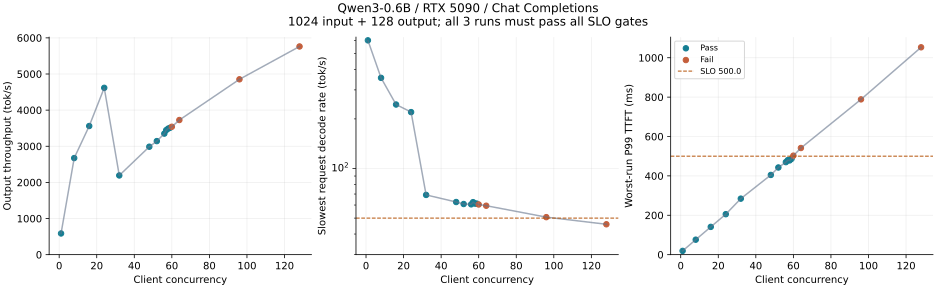
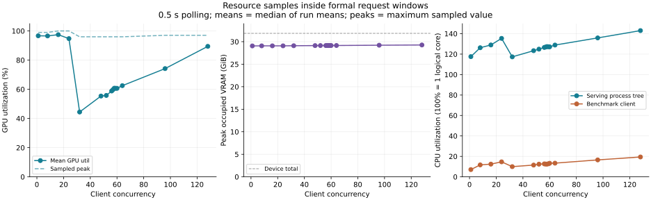

LLM 服务容量测试的目标，是找出**每路响应速度达标时能够承受的并发路数**，并明确这一并发对应的输入输出长度和资源开销。整机 tok/s 很高，并不意味着每个用户都足够快；短请求下通过的并发，也不一定适用于长上下文或长回答。

本文以单张 RTX 5090 上已经运行的 Qwen3-0.6B 为例，使用 `sglang.bench_serving` 的实现发送 **OpenAI 兼容的 `/v1/chat/completions` 流式请求**。按照测试目标、测试范围、测试方法、测试结论、报告出具五部分，给出并发边界、资源占用和长度劣化的实测结果。工具用法参见 [SGLang 官方评测指南](https://docs.sglang.io/docs/developer_guide/bench_serving) 与 [中文指南](https://docs.sglang.com.cn/developer_guide/bench_serving.html)。

## 1. 测试目标

### 1.1 找到满足单路响应标准的最大已验证并发

“一路”指一个持续请求的虚拟用户，任一时刻最多有一条 HTTP 请求在执行。客户端设置最大并发 C，请求完成后由后续任务补充，让服务在批次主体阶段维持约 C 条在途请求。本次每组至少 128 条请求、至少 6 轮并发请求，并重复 3 次。

先设置一套适用于交互演示的响应标准。它是本次测试采用的 SLO，不是行业统一要求；实际项目应根据用户体验确定。

| 验收项 | 本次标准 | 判定口径 |
| --- | --- | --- |
| 单路生成速率 | 至少 **50 token/s** | 逐条正式请求计算，所有成功请求均须满足，不能只看平均值或整机吞吐 |
| 首个输出等待 | **P99 TTFT ≤500 ms** | 每次运行分别判定 |
| 完整回答等待 | **P99 E2E ≤10 s** | 每次运行分别判定，约束长输出带来的总等待 |
| 生成期间卡顿 | **P99 ITL ≤100 ms** | 以当前客户端收到的非空流式内容块间隔统计 |
| 成功与稳定性 | 正式请求全部成功 | 无请求失败、超时或服务重启；未观察到 OOM 类错误，资源采样完整 |

首个输出后的单路生成速率定义为：

$$
R_i=\frac{L_{\mathrm{out},i}-1}{T_{\mathrm{E2E},i}-T_{\mathrm{TTFT},i}}
\quad\mathrm{token/s}
$$

时间使用秒。`R_i ≥50 token/s` 等价于该请求的 `TPOT ≤20 ms/token`。它衡量开始输出后的平均生成速度；首个输出等待与完整回答时间另由 TTFT、E2E 限制。逐请求速率要求全部达标，而 TTFT/E2E 使用 P99，不能把两种口径混为“每条请求的所有延迟都不超限”。

每个配置的三次运行必须全部满足上述条件，才记为通过。在通过的测点中找最大并发，并细化相邻通过/失败边界。由于执行路径可能随 batch size 变化，曲线未必单调，本次报告称它为**最大已验证并发**，不把未测试整数或其他服务配置下的全局最优当作已证实结论。

### 1.2 给出可使用的并发和长度组合

除边界值外，还要给出一套便于使用的配置：建议并发、最大输入 token 数、最大输出 token 数。方法是先在最大通过并发的约 80% 处留出策略余量并复测，再固定并发逐步增加输入、输出长度，观察指标劣化，最后验证二者同时达到建议上限的组合。

80% 是本次采用的保守选择策略，不表示预留了精确 20% 的 GPU 资源。长度建议必须绑定并发与响应标准，且不能超过已验证的组合边界。

## 2. 测试范围

### 2.1 场景与搜索范围

| 阶段 | 输入 / 输出 token | 并发与规模 | 目的 |
| --- | --- | --- | --- |
| 并发粗扫 | 1024 / 128 | C=1、8、16、24、32、48、64、96、128 | 找出通过区间与资源变化 |
| 边界细化 | 1024 / 128 | 在最大通过测点与其上方最近失败测点之间先按 4 路、再按 1 路细化 | 找到相邻已测通过/失败边界 |
| 余量配置基线 | 1024 / 128 | 从最大通过并发的 80% 向下取整，复测确认 | 给长度扫描选定固定并发 |
| 输入长度扫描 | 128、1024、2048、4096、8192 / 128 | 固定余量配置并发；向上遇到首个失败档后停止 | 观察长输入导致的首 token 与吞吐劣化 |
| 输出长度扫描 | 1024 / 128、256、512、1024、2048 | 固定余量配置并发；向上遇到首个失败档后停止 | 观察生成速率及完成时间劣化 |
| 输入输出组合 | 各自通过的最长输入、最长输出 | 二者同时施加，失败则缩减长度后复测 | 防止拼接独立测试的上限 |
| 加长组合验证 | 最终候选输入/输出 | 每次至少 max(512,12C) 条请求，重复 3 次 | 检查更长批次下是否仍然通过 |

除加长验证外，每组正式请求数为 `max(128,6C)`，均重复 3 次。长度表只列实际完成的档位；搜索范围中的更大长度如果未运行，就不能写成已经通过或已经失败。

输入为合成英文词序列，包含不同请求开头；**输入 token 数包含聊天模板开销**。使用本地 tokenizer 对每条数据校准，输出使用服务支持的 `ignore_eos=true` 固定长度，所有生成 token（包括思考相关输出）均计入工作量。这些数据适合控制工作量，不用于评估回答质量。

### 2.2 指标与资源采样

| 指标 | 含义与用途 |
| --- | --- |
| 最慢请求生成速率 | 所有正式请求 `R_i` 的最小值，直接检验每路至少 50 token/s |
| 低于速率标准的请求数 | 检查平均值是否掩盖慢请求；通过配置必须为 0 |
| TTFT、TPOT、ITL、E2E | 分别反映开始输出、生成速度、内容块间隔、完成时间 |
| 整机输出 tok/s、完成 req/s | 评估服务总吞吐；不能用整机吞吐除以 C 代替逐请求速率 |
| GPU 利用率、显存占用、功耗 | 判断不同并发和长度下设备繁忙程度与占用变化 |
| 服务端 CPU、RSS | 采集主服务进程及其子进程，观察调度、分词和内存开销 |
| 客户端 CPU、RSS | 识别压测程序自身的负载，避免将客户端瓶颈误认成 GPU 上限 |
| 主机 CPU、可用内存 | 提供其他主机负载与内存余量背景 |

资源以 **500 ms 间隔**采样，只保留从首个正式请求开始到最后一条正式请求结束的窗口；不把导入依赖、准备数据、预热或归档时间混进资源均值。GPU 数据来自 `nvidia-smi`，CPU/内存来自 `psutil`。显存、功耗等峰值是采样峰值，不是连续监测得到的绝对峰值。

CPU 利用率的 `100%` 表示使用一个逻辑核，可以超过 100%；主机总 CPU 百分比则按整机核数归一化。服务端内存使用进程树 RSS 之和，可能重复计算共享页，不能当作独占物理内存；客户端 RSS 单独列出。

本版本 Chat Completions 客户端的 ITL 是相邻非空 content/reasoning 内容块之间的间隔，一个块可能含多个 token。TTFT 也包含网络、排队、模板处理、分词和调度，不等于纯 GPU prefill 耗时。

### 2.3 实测环境与控制条件

| 项目 | 配置 |
| --- | --- |
| GPU | 单张 RTX 5090，驱动报告总显存 32607 MiB |
| 主机 | Intel Xeon Platinum 8575C，48 逻辑 CPU，约 371 GiB RAM |
| 软件 | 驱动 580.178.04；Python 3.12.14；PyTorch 2.13.0+cu130；CUDA runtime 13.0 |
| 推理栈 | SGLang 0.5.19；Transformers 5.12.1；FlashInfer 0.6.18；Triton 3.7.1 |
| 模型 | Qwen/Qwen3-0.6B，BF16 配置，dtype=auto，无权重量化，TP=1 |
| 服务参数 | FCFS；Radix Cache 开启；chunked prefill size=2048；decode CUDA Graph 最大 batch=24 |
| 接口与网络 | OpenAI Chat Completions，流式；客户端与服务同机，通过 loopback 访问 |
| 控制变量 | temperature=0；固定输入输出长度；每次预热 8 条，再清理前缀缓存后正式计时 |

服务已启动，本次不重启、不调整服务参数。清理前缀缓存不清除 CUDA Graph 或已经完成的内核初始化；组内缓存仍然开启。本机服务预留了较大的 KV cache，显存高占用不能全部解释为模型权重或当前请求实际占用。

## 3. 测试方法

### 3.1 确认服务接口与计数口径

测试直接访问5090机器上已经运行的Qwen3-0.6B服务，客户端和服务端位于同一主机，地址为 `http://127.0.0.1:30000`。推理请求使用 `/v1/chat/completions`，开启流式返回，并通过 `stream_options.include_usage=true` 获取实际token用量。

正式压测前，先发送少量短请求，检查服务名、流式内容、结束标志和usage是否正常。只有角色信息、没有正文的首个返回块不计作首个输出；收到非空content或reasoning内容后，才记录TTFT。输出计数采用服务返回的 `completion_tokens`，不直接把请求中的输出预算当作实际生成数量。

随后分别对128、1024、2048、4096、8192 token的候选输入做计数预检，核对服务返回的 `prompt_tokens` 与本地模板后长度一致。这一步只确认请求和计数正确，不代表这些长度已经通过性能验收。

### 3.2 构造并校准不同长度的请求

输入数据使用合成英文词序列，每条请求带有不同的开头，分别准备128、1024、2048、4096、8192 token五档候选输入，每档2048条。数据以OpenAI messages格式保存为JSONL，每行是一条独立请求；发送的是原始messages，由服务端应用聊天模板。

长度校准使用与服务相同的Qwen3 tokenizer和默认聊天模板，逐条检查模板后的token数量，再与上一节的服务端usage预检结果核对。因此，表中的输入长度包含聊天模板开销，而不是只计算user正文。

在 `sglang.bench_serving` 中，使用 `--dataset-name openai` 加载这些请求，通过 `--dataset-path` 选择输入长度对应的数据文件。输出长度由 `--sharegpt-output-len` 指定。虽然参数名带有ShareGPT，当前版本的OpenAI数据集同样使用它覆盖每条请求的输出预算，最终转换为Chat Completions请求的 `max_completion_tokens`。

本次固定 `temperature=0`，并使用SGLang支持的 `ignore_eos=true`，让每条请求达到指定输出长度，避免模型提前结束造成工作量不同。实际输出量仍通过usage核对。`ignore_eos` 是服务扩展，并非所有OpenAI兼容服务都支持。

当前环境的Transformers默认返回BatchEncoding，而所用SGLang版本的数据集加载器按token列表计算长度。本次仅在客户端显式设置 `return_dict=False`，使长度统计与实际token列表一致，服务端保持原配置。

### 3.3 使用sglang.bench_serving建立单路基线

本次由客户端调度程序在同一进程内反复调用 `sglang.bench_serving` 的官方CLI，逐组传入测试参数。请求发送、并发限制、流式计时和吞吐统计均使用该工具的实现；外围调度负责组织测试矩阵、保存补充明细和采集资源。

单路基线使用1024 token输入、128 token输出，设置1路并发、128条正式请求，重复3次。关键参数及其作用如下：

| 参数 | 单路基线设置 | 在本次测试中的作用 |
| --- | --- | --- |
| `--backend` | `sglang-oai-chat` | 使用OpenAI Chat Completions请求格式，访问 `/v1/chat/completions` |
| `--base-url` | `http://127.0.0.1:30000` | 指定服务根地址，工具追加接口路径 |
| `--model`、`--tokenizer` | 本地Qwen3-0.6B缓存目录 | 加载模型配置与分词器信息，避免准备阶段查询远端文件 |
| `--served-model-name` | `Qwen/Qwen3-0.6B` | 指定请求实际使用的服务模型名 |
| `--dataset-name`、`--dataset-path` | `openai`，1024 token输入的数据文件 | 加载已经校准长度的messages请求 |
| `--sharegpt-output-len` | 128 | 将每条请求的输出预算设为128 token |
| `--request-rate` | `inf` | 尽快创建请求任务，不以到达速率限制供压 |
| `--max-concurrency` | 1 | 同时只执行1条HTTP请求，后续请求等待名额 |
| `--num-prompts` | 128 | 指定正式请求数量，不包含预热请求 |
| `--warmup-requests` | 8 | 在正式计时前预热8条请求 |
| `--flush-cache` | 开启 | 预热后清理前缀缓存，再开始正式测试 |
| `--extra-request-body` | 开启流式usage和 `ignore_eos=true` | 核对真实输出量，并保持生成长度固定 |
| `--output-file`、`--output-details` | 每次运行分别保存JSONL和请求详情 | 保留聚合指标及逐请求TTFT、ITL、长度和错误信息 |

下面用官方模块的命令形式列出实际传入的参数。本次客户端已完成第3.2节的模板计数兼容处理；在相同版本组合下执行时也需要先满足这一前提。逐请求完整E2E补存和资源监控是额外采集，不属于以下命令的默认输出。

单路基线的执行命令如下，三个结果文件分别对应三次重复；后续命令沿用这里的环境变量。输入数据已按第3.2节准备，结果目录使用新的目录，避免JSONL追加混入旧记录。

```bash
export CUDA_VISIBLE_DEVICES=""
export HF_HUB_OFFLINE=1
export TOKENIZERS_PARALLELISM=false
BASE_URL=http://127.0.0.1:30000
TOKENIZER=/path/to/Qwen3-0.6B
DATA_DIR=./datasets
RESULT_DIR=./bench-results
mkdir -p "$RESULT_DIR"

for REP in 1 2 3; do
  python -m sglang.bench_serving \
    --backend sglang-oai-chat --base-url "$BASE_URL" \
    --model "$TOKENIZER" --tokenizer "$TOKENIZER" \
    --served-model-name Qwen/Qwen3-0.6B \
    --dataset-name openai --dataset-path "$DATA_DIR/chat-1024.jsonl" \
    --sharegpt-output-len 128 \
    --request-rate inf --max-concurrency 1 \
    --num-prompts 128 --seed 42 --temperature 0 \
    --warmup-requests 8 --flush-cache --disable-tqdm \
    --extra-request-body '{"stream_options":{"include_usage":true},"ignore_eos":true}' \
    --output-file "$RESULT_DIR/c1-rep${REP}.jsonl" --output-details
done
```

每次运行先完成预热，再清理前缀缓存，随后正式计时。服务本身没有重启，模型、精度、调度与CUDA Graph配置保持不变。客户端只作为CPU HTTP请求发生器使用，没有在GPU上加载第二份模型。

单路速率的验收需要完整的逐请求E2E。当前工具的默认详情不直接保存这一项，因此本次在官方聚合前补存每条请求的开始时间、完整E2E、TTFT和输出token数，再按第1节公式计算生成速率。这一补充只用于保存明细，沿用工具原有的请求计时结果。

**结果解析：** 先核对成功数是否为128，输入与输出总量是否分别为 `128×1024` 和 `128×128`，再检查错误记录及每条请求的生成速率。验收关注所有请求中的最小速率和低于50 token/s的请求数，而不是只看平均TPOT。

### 3.4 搜索最大已验证并发

并发扫描继续使用相同的1024/128输入输出配置，保持 `--request-rate inf`，只改变 `--max-concurrency`。先测试1、8、16、24、32、48、64、96、128路；每组将 `--num-prompts` 设为 `max(128,6C)`，保证至少128条正式请求、至少6轮并发请求，并分别运行3次。

粗扫得到通过与失败区间后，在边界内先按4路、再按1路补测。最终补测了52、56、60路，以及57、58、59路。每次只改变并发参数，输入数据、输出长度、预热、缓存处理和验收规则保持一致；各次结果单独保存，防止将一次通过当作整个配置通过。

并发扫描与边界补测使用下面的参数矩阵。1路结果已计入单路基线，这里不重复执行；`N` 随并发调整为至少6轮请求。实测由调度程序在上一配置完成后传入下一组参数，下面用循环展示相同的执行参数。

```bash
for C in 8 16 24 32 48 64 96 128 52 56 60 57 58 59; do
  N=$((6 * C))
  if [ "$N" -lt 128 ]; then N=128; fi
  for REP in 1 2 3; do
    python -m sglang.bench_serving \
      --backend sglang-oai-chat --base-url "$BASE_URL" \
      --model "$TOKENIZER" --tokenizer "$TOKENIZER" \
      --served-model-name Qwen/Qwen3-0.6B \
      --dataset-name openai --dataset-path "$DATA_DIR/chat-1024.jsonl" \
      --sharegpt-output-len 128 \
      --request-rate inf --max-concurrency "$C" \
      --num-prompts "$N" --seed 42 --temperature 0 \
      --warmup-requests 8 --flush-cache --disable-tqdm \
      --extra-request-body '{"stream_options":{"include_usage":true},"ignore_eos":true}' \
      --output-file "$RESULT_DIR/c${C}-rep${REP}.jsonl" --output-details
  done
done
```

**结果解析：** 每个配置要同时检查各项 SLO。下面的吞吐取三次中位数；最慢请求速率取三次所有请求的最小值；P99 延迟取三次运行级 P99 的最大值，便于直接对照“三次均通过”的规则。

| 并发C | 最慢请求 token/s | 慢请求数 | P99 TTFT ms | P99 E2E ms | 输出 tok/s | 完成 req/s | 判定 |
| --- | --- | --- | --- | --- | --- | --- | --- |
| 1 | 599.61 | 0 | 19.08 | 223.25 | 586 | 4.58 | 通过 |
| 8 | 354.95 | 0 | 76.01 | 388.21 | 2,673 | 20.88 | 通过 |
| 16 | 244.52 | 0 | 140.99 | 579.11 | 3,560 | 27.81 | 通过 |
| 24 | 219.94 | 0 | 205.43 | 665.78 | 4,617 | 36.07 | 通过 |
| 32 | 69.12 | 0 | 284.41 | 1,922.02 | 2,192 | 17.12 | 通过 |
| 48 | 62.60 | 0 | 404.78 | 2,106.11 | 2,987 | 23.34 | 通过 |
| 52 | 60.88 | 0 | 442.64 | 2,164.22 | 3,142 | 24.55 | 通过 |
| 56 | 60.60 | 0 | 469.82 | 2,173.92 | 3,350 | 26.17 | 通过 |
| 57 | 62.48 | 0 | 479.77 | 2,139.24 | 3,446 | 26.93 | 通过 |
| 58 | 61.27 | 0 | 478.58 | 2,174.76 | 3,487 | 27.24 | 通过 |
| 59 | 61.21 | 0 | 486.25 | 2,186.22 | 3,509 | 27.41 | 通过 |
| 60 | 60.47 | 0 | 502.75 | 2,213.24 | 3,540 | 27.65 | TTFT超限 |
| 64 | 59.44 | 0 | 541.54 | 2,226.64 | 3,726 | 29.11 | TTFT超限 |
| 96 | 50.67 | 0 | 788.54 | 2,629.71 | 4,853 | 37.91 | TTFT超限 |
| 128 | 45.86 | 460 | 1,053.03 | 3,034.31 | 5,762 | 45.01 | 460条速率不足；TTFT超限 |



在默认 **1024 输入 / 128 输出**下，本次最大已验证并发为 **59 路**：三次所有请求中的最低生成速率为 61.21 token/s，最差一次 P99 TTFT 为 486.25 ms，输出吞吐中位数为 3,509 tok/s。 相邻已测 60 路未通过，原因是TTFT超限；其 P99 TTFT 为 502.75 ms，最低生成速率为 60.47 token/s。在通过SLO的测点中，最高输出吞吐出现在 24 路，约 4,617 tok/s。本文以最大达标在途路数为目标；若项目优先追求达标吞吐，应另行采用这个吞吐最优点。

吞吐曲线不是单调上升，不能只按吞吐选配置。当前服务的 decode CUDA Graph 最大 batch 为24，跨越这个范围可能改变执行路径；本次没有做 profiler 或配置对照，不把相关性写成已经确认的根因。

最大并发限制的是客户端同时执行的请求数。SGLang 在取得客户端并发名额后才开始单请求计时，等待名额的时间不计入 TTFT/E2E。因此这里衡量持续 C 路访问时的服务响应，不能证明任意突发流量在业务网关中的完整等待时间。批次开始、结束也有并发爬升和排空阶段。

### 3.5 对照资源占用

资源占用通过独立监控与基准测试同步采集，并非全部来自 `sglang.bench_serving` 的输出。测试期间每500 ms调用一次 `nvidia-smi`，记录目标GPU的利用率、显存占用、总显存和功耗；同时用 `psutil` 记录SGLang主进程及子进程、压测客户端的CPU和RSS，以及主机CPU和可用内存。

每次测试结束后，使用首条正式请求的开始时间与最后一条正式请求的结束时间截取资源样本，排除准备数据、预热和结果保存阶段。对截取后的样本计算均值与采样峰值，再与对应并发配置的延迟和吞吐结果关联。

**结果解析：** GPU 利用率反映设备繁忙程度，显存反映进程预留与实际分配的合计。高并发下显存变化小，不等于 KV cache 没有增长：本服务预分配的缓存可能早已占住显存。CPU 分别看服务进程树和客户端，不能仅凭 GPU 利用率较低就认定 GPU 空闲或模型仍可无条件增加并发。

| 并发C | GPU利用率均值 / 峰值 % | 显存峰值 MiB | 最少空闲 MiB | 功耗均值 / 峰值 W |
| --- | --- | --- | --- | --- |
| 1 | 96.7 / 99 | 29,755 | 2,852 | 326.7 / 343.9 |
| 8 | 96.6 / 99 | 29,771 | 2,836 | 324.3 / 358.2 |
| 16 | 97.4 / 100 | 29,773 | 2,834 | 331.3 / 375.8 |
| 24 | 94.8 / 100 | 29,775 | 2,832 | 369.3 / 432.0 |
| 32 | 44.4 / 96 | 29,799 | 2,808 | 222.9 / 266.5 |
| 48 | 55.4 / 96 | 29,829 | 2,778 | 276.5 / 327.3 |
| 52 | 55.8 / 96 | 29,837 | 2,770 | 290.3 / 346.1 |
| 56 | 58.8 / 96 | 29,841 | 2,766 | 297.9 / 357.1 |
| 57 | 59.8 / 96 | 29,843 | 2,764 | 305.5 / 364.2 |
| 58 | 60.8 / 96 | 29,841 | 2,766 | 309.5 / 367.5 |
| 59 | 60.7 / 96 | 29,845 | 2,762 | 309.0 / 370.7 |
| 60 | 60.7 / 96 | 29,847 | 2,760 | 307.5 / 368.9 |
| 64 | 62.5 / 96 | 29,853 | 2,754 | 307.7 / 371.8 |
| 96 | 74.2 / 97 | 29,915 | 2,692 | 382.3 / 444.0 |
| 128 | 89.4 / 97 | 29,967 | 2,640 | 427.1 / 469.0 |

| 并发C | 服务CPU均值 / 峰值 % | 服务RSS峰值 GiB | 客户端CPU均值 / 峰值 % | 客户端RSS峰值 GiB | 主机可用内存最小 GiB |
| --- | --- | --- | --- | --- | --- |
| 1 | 117.5 / 124.9 | 5.49 | 7.1 / 10.8 | 1.26 | 272.6 |
| 8 | 126.3 / 133.5 | 5.49 | 11.7 / 15.8 | 1.27 | 272.6 |
| 16 | 129.0 / 135.1 | 5.49 | 12.4 / 16.4 | 1.27 | 272.6 |
| 24 | 135.4 / 144.6 | 5.49 | 14.7 / 19.3 | 1.27 | 272.6 |
| 32 | 117.3 / 134.0 | 5.49 | 10.0 / 13.4 | 1.27 | 272.6 |
| 48 | 123.4 / 151.1 | 5.49 | 11.5 / 16.8 | 1.27 | 272.6 |
| 52 | 124.9 / 153.2 | 5.49 | 12.4 / 18.2 | 1.28 | 272.6 |
| 56 | 126.5 / 163.8 | 5.49 | 12.7 / 19.0 | 1.28 | 272.6 |
| 57 | 126.9 / 156.7 | 5.49 | 12.5 / 23.0 | 1.28 | 272.5 |
| 58 | 127.4 / 158.1 | 5.49 | 12.5 / 19.9 | 1.28 | 272.5 |
| 59 | 127.2 / 159.3 | 5.49 | 12.7 / 20.7 | 1.28 | 272.5 |
| 60 | 127.1 / 160.5 | 5.49 | 13.3 / 19.7 | 1.28 | 272.5 |
| 64 | 128.9 / 161.4 | 5.49 | 13.4 / 22.8 | 1.27 | 272.6 |
| 96 | 135.9 / 184.0 | 5.49 | 16.6 / 30.0 | 1.28 | 272.6 |
| 128 | 143.0 / 243.4 | 5.49 | 19.4 / 79.8 | 1.28 | 272.6 |



以最大通过的 59 路为例，GPU 利用率均值约 60.7%，显存采样峰值 29,845 MiB，最少空闲 2,762 MiB；服务端 CPU 均值 127.2%，客户端均值 12.7%。这些是整项工作负载的资源占用，不能简单除以路数当作每路独占成本。

高 GPU 利用率也不代表吞吐已经达到上限，仍要对照批处理与延迟结果；利用率下降时，也不能只凭这一项诊断瓶颈。资源表给出证据，具体内核或调度原因仍需 profiler 验证。

### 3.6 固定并发扫描长度，观察劣化

并发边界确定为59路后，取其80%并向下取整，得到47路候选配置。先在47路重新测试1024/128基线，确认三次通过，再将 `--max-concurrency` 固定为47，开始长度对照。

本次长度扫描固定为 **47 路**，其 1024/128 基线最低请求速率 64.50 token/s、P99 TTFT 397.79 ms、P99 E2E 2,090.24 ms。

输入扫描保持 `--sharegpt-output-len 128`，通过切换 `--dataset-path` 依次使用128、1024、2048 token的数据。2048 token档三次未通过，因此没有继续对4096和8192 token档施加性能负载。

输出扫描固定1024 token输入数据，将 `--sharegpt-output-len` 依次设为128、256、512、1024。1024 token输出档未通过，扫描在此停止。两种扫描均保持47路、每次282条正式请求、重复3次，其他参数与基线相同。

输入长度对照的命令如下。其中1024/128配置也用于建立47路基线。

```bash
for INPUT in 1024 128 2048; do
  for REP in 1 2 3; do
    python -m sglang.bench_serving \
      --backend sglang-oai-chat --base-url "$BASE_URL" \
      --model "$TOKENIZER" --tokenizer "$TOKENIZER" \
      --served-model-name Qwen/Qwen3-0.6B \
      --dataset-name openai --dataset-path "$DATA_DIR/chat-${INPUT}.jsonl" \
      --sharegpt-output-len 128 \
      --request-rate inf --max-concurrency 47 \
      --num-prompts 282 --seed 42 --temperature 0 \
      --warmup-requests 8 --flush-cache --disable-tqdm \
      --extra-request-body '{"stream_options":{"include_usage":true},"ignore_eos":true}' \
      --output-file "$RESULT_DIR/in${INPUT}-c47-rep${REP}.jsonl" --output-details
  done
done
```

输出长度对照固定1024 token输入，128 token输出结果复用上述基线，只补测更长输出：

```bash
for OUTPUT in 256 512 1024; do
  for REP in 1 2 3; do
    python -m sglang.bench_serving \
      --backend sglang-oai-chat --base-url "$BASE_URL" \
      --model "$TOKENIZER" --tokenizer "$TOKENIZER" \
      --served-model-name Qwen/Qwen3-0.6B \
      --dataset-name openai --dataset-path "$DATA_DIR/chat-1024.jsonl" \
      --sharegpt-output-len "$OUTPUT" \
      --request-rate inf --max-concurrency 47 \
      --num-prompts 282 --seed 42 --temperature 0 \
      --warmup-requests 8 --flush-cache --disable-tqdm \
      --extra-request-body '{"stream_options":{"include_usage":true},"ignore_eos":true}' \
      --output-file "$RESULT_DIR/out${OUTPUT}-c47-rep${REP}.jsonl" --output-details
  done
done
```

**结果解析：** 输入增长主要观察 TTFT 相对基线放大多少，同时检查单路速率和吞吐；输出增长重点看 E2E 和生成速率是否超标。相对劣化都与**相同并发下的 1024/128 基线**比较，不能拿单并发数据来替代。

| 输入 / 输出 | 最慢请求 token/s | P99 TTFT ms | TTFT劣化倍数 | P99 E2E ms | 输出 tok/s | GPU均值 % | 显存峰值 MiB | 判定 |
| --- | --- | --- | --- | --- | --- | --- | --- | --- |
| 128 / 128 | 70.80 | 90.55 | 0.23× | 1,828.51 | 3,489 | 21.3 | 29,835 | 通过 |
| 1024 / 128 | 64.50 | 397.79 | 1.00× | 2,090.24 | 2,942 | 56.3 | 29,831 | 通过 |
| 2048 / 128 | 51.72 | 891.59 | 2.24× | 2,603.71 | 2,352 | 76.0 | 29,833 | TTFT超限 |

| 输入 / 输出 | 最慢请求 token/s | P99 TTFT ms | P99 E2E ms | E2E劣化倍数 | 输出 tok/s | GPU均值 % | 显存峰值 MiB | 判定 |
| --- | --- | --- | --- | --- | --- | --- | --- | --- |
| 1024 / 128 | 64.50 | 397.79 | 2,090.24 | 1.00× | 2,942 | 56.3 | 29,831 | 通过 |
| 1024 / 256 | 69.55 | 396.65 | 3,743.62 | 1.79× | 3,267 | 48.6 | 29,831 | 通过 |
| 1024 / 512 | 73.12 | 397.20 | 7,061.94 | 3.38× | 3,456 | 48.7 | 29,833 | 通过 |
| 1024 / 1024 | 75.41 | 396.89 | 13,661.86 | 6.54× | 3,558 | 55.5 | 29,833 | E2E超限 |

在 47 路下，单独增加输入时最长已通过档为 **1024 token**；单独增加输出时最长已通过档为 **512 token**。输入增至 2048 token 时出现TTFT超限。输出增至 1024 token 时出现E2E超限。这些先作为组合测试候选，最终发布上限以组合及加长验证为准。

本组输入从1024增至2048 token，P99 TTFT放大到基线的 2.24 倍。输出增长时，最慢请求的平均生成速率并未下降，但P99 E2E从 2.09 秒升至 13.66 秒。因此，本次输入上限主要受首个输出等待限制，输出上限主要受完整回答时间限制，不能仅看生成速率是否达标。

输入建议上限按完整 messages 应用聊天模板后的 token 数计算，包含系统提示和历史消息，不能只数最后一句 user 文本。

本次选取的长度是配置建议档位，不是逐 token 找到的物理极限。本次输入通过 1024、失败 2048，只能建议不超过已验证的 1024 档，不能断言 1025 就失败。输入还要为输出和模板留出模型上下文空间，不能把模型声明的上下文长度直接当作延迟达标的建议输入长度。

### 3.7 验证组合上限并归档

输入、输出单独增加都通过，不代表同时增加也通过。本次将已通过的输入1024 token与输出512 token组合，在47路下重新运行三次，每次282条请求；通过后保持相同配置，仅将 `--num-prompts` 增至564，再做三次加长验证。

组合与加长验证的命令如下。先运行每次282条请求的组合测试，再只把请求数增加到564；两档各重复三次。

```bash
for N in 282 564; do
  for REP in 1 2 3; do
    python -m sglang.bench_serving \
      --backend sglang-oai-chat --base-url "$BASE_URL" \
      --model "$TOKENIZER" --tokenizer "$TOKENIZER" \
      --served-model-name Qwen/Qwen3-0.6B \
      --dataset-name openai --dataset-path "$DATA_DIR/chat-1024.jsonl" \
      --sharegpt-output-len 512 \
      --request-rate inf --max-concurrency 47 \
      --num-prompts "$N" --seed 42 --temperature 0 \
      --warmup-requests 8 --flush-cache --disable-tqdm \
      --extra-request-body '{"stream_options":{"include_usage":true},"ignore_eos":true}' \
      --output-file "$RESULT_DIR/joint-47-1024-512-n${N}-rep${REP}.jsonl" --output-details
  done
done
```

| 阶段 | 并发 | 输入 / 输出 | 每次请求数 | 每次时长 s | 最慢请求 token/s | P99 TTFT ms | P99 E2E ms | 判定 |
| --- | --- | --- | --- | --- | --- | --- | --- | --- |
| 组合 | 47 | 1024 / 512 | 282 | 41.8–42.0 | 72.86 | 400.39 | 7,089.10 | 通过 |
| 加长验证 | 47 | 1024 / 512 | 564 | 83.7–84.2 | 72.61 | 397.64 | 7,111.06 | 通过 |

最终加长验证通过的组合为 **47 路并发、输入上限 1024 token、输出上限 512 token**。每次 564 条请求，三次共 1692 条，单次测试约 83.7–84.2 秒。三次最慢请求生成速率 72.61 token/s，P99 TTFT 最大值 397.64 ms，P99 E2E 最大值 7,111.06 ms，慢请求数为 0。

**结果解析：** 加长验证只增加正式请求数量，`--max-concurrency`、输入数据和 `--sharegpt-output-len` 均不改变，因此可以检查更多轮连续请求下是否仍然满足同一标准。每次运行分别核对成功数、最慢请求速率及延迟分位数，三次均通过后才形成建议配置。

结果归档包含 `sglang.bench_serving` 的脱敏JSONL、补存的逐请求完成时间、资源时间序列和测试参数。汇总时重新计算单路生成速率、延迟分位数和吞吐，检查资源样本是否位于正式请求窗口，并逐次判定SLO。资源峰值取三次采样的最大值，均值取三次运行均值的中位数。

逐请求明细、资源采样、日志和合成输入数据仅在本地留存，不随博客发布。本文保留结果摘要、图表和测试方法；路径中的账户信息已脱敏。

- [配置汇总与建议](experiments/capacity-summary.json)

本次使用SGLang 0.5.19，其中 `sglang.bench_serving` 是指向 `sglang.benchmark.serving` 的旧入口。容量测试始终使用其官方请求与统计实现，补充的只是测试组织、明细保存和资源监控。`ignore_eos` 与清理缓存属于服务相关能力，不能因为推理接口兼容OpenAI，就假定所有部署都具备相同的扩展功能。

## 4. 测试结论

本次共完成 **23 组配置、69 次运行、21,978 条正式请求**，并采集了逐请求时序和相应资源样本。按本次响应标准：

- **默认长度下的最大已验证并发：59 路，输入/输出为1024/128 token。** 这是边界测点，不作为长请求默认配置。
- **通过SLO的最高吞吐测点：24 路，约 4,617 tok/s。** 最大达标路数与吞吐最优点分别记录，避免把不同目标混称为一个最佳值。
- **建议使用的组合：47 路，最大输入 1024 token，最大输出 512 token。** 三次加长验证均通过，各项结果见第3.7节。
- **长度限制来自响应目标，而非“模型能接收多长”。** 单轴扫描的最长通过档为输入 1024、输出 512 token；最终建议仍以组合验证值为准。
- **资源占用与响应达标要一起看。** 建议组合的 GPU 利用率均值约 50.0%，显存峰值 29,831 MiB，功耗均值 268.9 W，服务CPU均值 119.1%，客户端CPU均值 12.2%。

建议组合是对已经测量的边界负载给出的配置上限，不表示已穷举范围内所有长短请求混合方式。真实业务还需要对输入输出分布、缓存命中和队列策略进行回放验证。

建议值的适用条件包括：本次模型与软件版本、默认聊天模板、合成定长请求、固定并发、本机网络、已预热服务和当前缓存设置。资源预留、不同内容、真实输出长度分布、跨机网络或多个用户混合访问，都可能改变边界。

单路速率“全部通过”仅说明本次样本中未观察到慢请求，不保证线上永远没有慢请求。本次完成边界搜索与加长批次验证，未做长期稳态、冷启动、故障恢复和回答质量验收。建议上线前以脱敏生产请求验证，并监控实际 TTFT、逐请求速率和队列长度。

## 5. 报告出具

### 5.1 报告应围绕容量问题出结论

正式报告至少包含：测试对象与版本、单路响应标准、并发和长度矩阵、逐请求验收口径、延迟/吞吐/资源结果、最大已验证并发、建议发布组合、限制与后续验证项。正式报告应在测试侧留存测试参数、输入数据、逐请求时序、资源时间序列、服务配置和校验值；这些过程记录不必作为博客附件发布。

不要只写“最大吞吐达到某值”，也不要只给出互相独立的最大并发、最大输入、最大输出。可使用的结论应明确为 **C 路并发 + 输入上限 + 输出上限 + 响应标准 + 对应资源开销**，并有组合测试支持。

### 5.2 报告示例：Qwen3-0.6B 单卡服务容量测试

| 项目 | 内容 |
| --- | --- |
| 报告编号 | 示例：LLM-CAPACITY-20261105-01 |
| 日期、状态 | 2026-11-05；实测报告示例，正式出具时填写执行人、复核人与版本 |
| 对象 | 单张 RTX 5090，Qwen/Qwen3-0.6B，SGLang 0.5.19，OpenAI Chat Completions |
| 验收标准 | 每条正式请求生成速率≥50 token/s；每次运行 P99 TTFT≤500ms、P99 E2E≤10s、P99 ITL≤100ms；全部成功 |
| 资源口径 | 正式窗口每500ms采样；GPU/显存/功耗，服务端与客户端 CPU/RSS；峰值为采样峰值 |
| 执行环境 | 本文第2.3节配置，未重启或修改服务参数 |

**执行规模与方法：** 共 23 组、每组3次、21,978 条正式请求。1024/128 的阶梯并发扫描后细化边界；在余量配置下扫描长度，再验证输入输出组合与加长批次。通过要求为三次各自全部满足SLO，资源只统计正式请求窗口。

**容量结论：** 默认1024/128长度下最大已验证并发为 59 路，最低请求速率 61.21 token/s，P99 TTFT 最大值 486.25 ms。相邻已测 60 路因TTFT超限未通过。

**建议配置与验证：** 建议 47 路并发，输入不超过 1024 token、输出不超过 512 token。对应组合每次 564 条请求、持续 83.7–84.2 秒，三次均通过；最低请求生成速率 72.61 token/s，P99 TTFT 397.64 ms、P99 E2E 7,111.06 ms、P99 ITL 13.80 ms。

**资源摘要：** 建议组合 GPU 利用率均值 50.0%、采样峰值 96%；显存峰值 29,831 MiB、最少空闲 2,776 MiB；功耗均值/峰值 268.9/346.8 W；服务端 CPU 均值/峰值 119.1/152.2%，进程树 RSS 峰值 5.49 GiB；客户端 CPU 均值/峰值 12.2/17.2%，RSS 峰值 1.32 GiB。

**适用边界：** 结论仅覆盖所记录配置、本机已预热服务及合成负载，不构成长时间稳定性或生产上线通过结论。建议配置保留了并发策略余量，但未验证所有混合长度和突发流量。逐请求记录、资源时间序列、实际命令、输入数据与服务配置在测试侧留存，用于追溯判断；博客仅保留汇总结果。

报告复核应确认：慢请求没有被平均值掩盖；三次运行分别通过；边界相邻失败点和失败原因已记录；长度建议由组合测试支持；资源统计没有混入准备阶段；显存预分配和共享内存没有被误解为每路独占成本。
